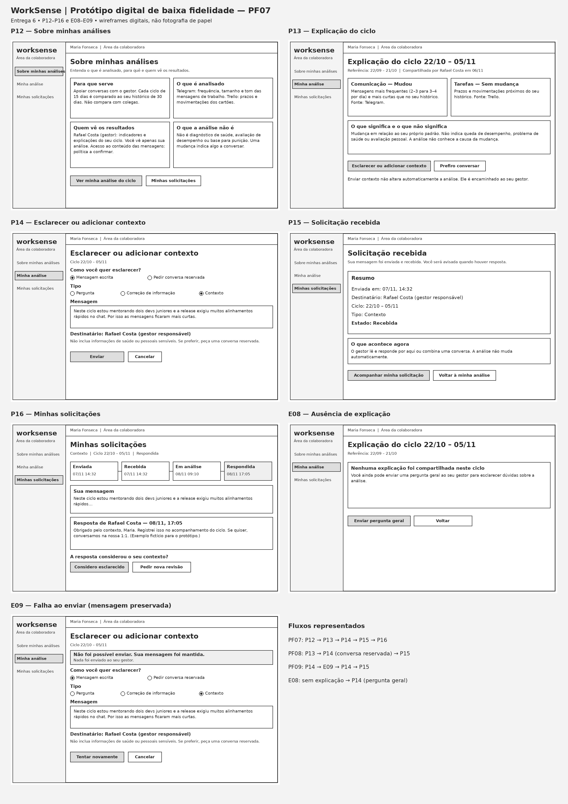

# Entrega 6 — Prototipação em papel

**Data:** {{04/11/2026}}  
**Status:** 🟩 Concluida
**Responsabilidade:** 1 solução integrada por equipe

## Objetivo da atividade

Externalizar rapidamente ideias de interação em baixa fidelidade para explorar alternativas antes de investir em detalhes visuais. O valor da atividade está no **ciclo construir → simular → observar → revisar**, não na beleza do desenho.

## 1. Escopo do protótipo

**Personas:** P02 — João Pedro (primária, gestor de operações não analítico).  
**Cenários/tarefas cobertos:** C02 / T02 (triagem rápida e encaminhamento, Entrega 5); T07 da Entrega 1 (cadastrar e vincular colaboradores) como fluxo de apoio.  
**Objetivos principais:** responder "preciso me preocupar ou não?" em poucos minutos, sem jargão; verificar a confiabilidade antes de agir; registrar o encaminhamento com justificativa, sem diagnóstico nem veredito automático.

## 1.1 Possíveis famílias de interface

Escolha apenas o que for coerente com tarefas e cenários. Para TCCs técnicos, o protótipo pode explorar:

- **dashboard** para monitoramento e tomada de decisão;
- **configuração/parametrização** para preparar algoritmo/modelo/processo;
- **entrada/seleção de dados** com validação;
- **acompanhamento de execução** com progresso, fila, cancelamento e recuperação;
- **relatório/resultados** com explicação, gráficos e exportação;
- **histórico** com busca, filtros, ordenação e detalhes;
- **comparação** entre execuções, versões, algoritmos ou períodos;
- **administração** de usuários, papéis, permissões ou entidades do domínio;
- **auditoria/logs** traduzidos para o perfil;
- **alertas/ocorrências** com ação de resposta.

> Não desenhe todas essas telas por obrigação. O objetivo da baixa fidelidade é experimentar a **estrutura da interação** necessária para as tarefas priorizadas.

## 2. Fluxos escolhidos

| Fluxo | Tarefa/objetivo | Por que foi priorizado |
|---|---|---|
| PF01 | Entrar como gestor e cadastrar um colaborador (T07) | Sem colaboradores vinculados não há dados para acompanhar; é o fluxo de apoio do recorte de IHC |
| PF02 | Triagem rápida: ler o resumo, decidir não aprofundar e registrar (HTA 1 > 2 > 5) | Tarefa mais frequente do João Pedro, com cerca de 15 minutos entre reuniões (C02.Q2) |
| PF03 | Triagem completa: aprofundar, verificar confiabilidade e registrar, incluindo o desvio "aguardar dados" (HTA 1 > 2 > 3 > 4 > 5) | Tarefa crítica (H17): evita agir sobre análise incompleta e prejudicar alguém injustamente |

## 3. Telas e estados

| ID | Tela/estado | Fluxo | Controles que mudam o estado |
|---|---|---|---|
| P01 | Login do gestor (e-mail, senha, "Esqueceu a senha?", aviso "O login é apenas para gestores") — *Screen 2* | PF01 | Login → P03; falha → E01 |
| P02 | Cadastrar colaboradores (nome, sobrenome, e-mail, telefone, Telegram ID, Trello ID) dentro do menu lateral do gestor — *Screen 4* | PF01 | Salvar → confirmação e volta ao P03; campo inválido → E02 |
| P03 | Visão geral (Dashboard): resumo da equipe em linguagem simples, com sinalização se houver; nomes discretos | PF02/PF03 | Selecionar sinalização → P04; menu lateral → P02 |
| P04 | Significado da sinalização: "o que este sinal significa e não significa" e opção de aprofundar | PF02/PF03 | Aprofundar → P05; Não aprofundar → P06 |
| P05 | Confiabilidade: períodos (30 e 15 dias), atualização, estado da análise e explicação resumida; "ver detalhes" e "o que significa?" opcionais | PF03 | Continuar → P06; sem dados/incompleta/insuficiente → E03 |
| P06 | Registro: encaminhamento (apoiar, acompanhar, não intervir, aguardar dados) e justificativa | PF02/PF03 | Confirmar → P07; Voltar → tela anterior |
| P07 | Confirmação do registro | PF02/PF03 | Voltar à visão geral → P03 |
| E01 | Login inválido: mensagem clara, campos preservados | PF01 | Corrigir e tentar de novo |
| E02 | Cadastro com campo vazio ou ID já vinculado | PF01 | Corrigir campo |
| E03 | Análise não confiável: aviso distinto de "sem alteração relevante"; só permite "aguardar dados" | PF03 | Seguir para P06 com "aguardar dados" pré-selecionado |
| E04 | Retomada após interrupção: reabre no colaborador e na etapa em que parou | PF02/PF03 | Continuar |

## 4. Simulação / walkthrough

**Participante:** Laura de Souza Parente (não participou da elaboração das telas)  
**Data:** {{04/11/2026}}  
**Cenário dado:** "Você é gestora de atendimento, tem 15 minutos entre duas reuniões e quer saber se precisa se preocupar com alguém da equipe. Decida e deixe registrado."

| Observação | Tela/ação | Evidência | Consequência para o design |
|---|---|---|---|
| {{...}} | P03 / Leitura inicial do resumo | {{o que ela disse ou fez}} | {{...}} |
| {{...}} | P04 / Texto "o que significa e não significa" | {{...}} | {{...}} |
| {{...}} | P05 e E03 / Distinguir "sem alteração" de "sem dados" | {{...}} | {{...}} |
| {{...}} | P02 / Preencher Telegram ID e Trello ID | {{...}} | {{...}} |
| {{...}} | P06 / Escolher encaminhamento e justificar | {{...}} | {{...}} |

## 5. Alterações após a simulação

As quatro primeiras linhas vêm da revisão que a equipe fez no protótipo antes da simulação, com base nas Entregas 1 a 5. As alterações decorrentes do teste com a Laura entram nas linhas seguintes.

| Antes | Problema | Depois | Justificativa |
|---|---|---|---|
| Telas em moldura de celular | A Entrega 1 (H21) e a Entrega 3 (H08, CT01) indicam o notebook como dispositivo principal | Telas redesenhadas em formato site, com menu lateral | Coerência com o contexto de uso definido |
| Login e tela inicial separados, com uma tela intermediária | Um passo a mais para um gestor com pouco tempo (C02.Q2) | Login e tela inicial unificados em uma única tela (P01) | Menos etapas até chegar à triagem |
| Campos Trello ID e Telegram ID com o mesmo texto de ajuda | O João Pedro tem pouca familiaridade técnica (P02) e não saberia diferenciar cada ID | Campos com rótulos distintos: "Telegram ID" e "Trello ID" | Reduz erro de vínculo entre colaborador e fontes de dados |
| Telas sem estado de erro | Senha errada, campo vazio ou ID duplicado deixavam o usuário sem saída | Estados E01 e E02 previstos, com mensagem clara e campos preservados | Prevenção e recuperação de erro |
| {{alteração decorrente da simulação com a Laura}} | {{...}} | {{...}} | {{...}} |

---

## 1. Escopo do protótipo

**Personas:** Rafael Costa (P01), gestor.  
**Cenários/tarefas cobertos:** E4-C01.  
**Objetivos principais:** T01 — Consultar uma análise e registrar o próximo passo humano. 

## 1.1 Possíveis famílias de interface

Escolha apenas o que for coerente com tarefas e cenários. Para TCCs técnicos, o protótipo pode explorar:

- **dashboard** para monitoramento e tomada de decisão;
- **configuração/parametrização** para preparar algoritmo/modelo/processo;
- **entrada/seleção de dados** com validação;
- **acompanhamento de execução** com progresso, fila, cancelamento e recuperação;
- **relatório/resultados** com explicação, gráficos e exportação;
- **histórico** com busca, filtros, ordenação e detalhes;
- **comparação** entre execuções, versões, algoritmos ou períodos;
- **administração** de usuários, papéis, permissões ou entidades do domínio;
- **auditoria/logs** traduzidos para o perfil;
- **alertas/ocorrências** com ação de resposta.

> Não desenhe todas essas telas por obrigação. O objetivo da baixa fidelidade é experimentar a **estrutura da interação** necessária para as tarefas priorizadas.

## 2. Fluxos escolhidos

| Fluxo | Tarefa/objetivo | Por que foi priorizado |
|---|---|---|
| PF04 | Selecionar colaborador e período → conferir evidências → definir próximo passo → registrar → conferir confirmação | Cobre o caminho principal de T01 e as etapas 1, 2 e 3 do HTA de Rafael |
| PF05 | Selecionar análise incompleta → verificar a limitação → registrar insuficiência e responsável pela retomada → conferir confirmação | Impede tratar ausência de dados como estabilidade ou como prova de problema |
| PF06 | Tentar registrar com campo obrigatório vazio ou simular falha ao salvar → corrigir ou tentar novamente → conferir confirmação | Distingue tentativa de envio de registro efetivamente concluído |

## 3. Telas e estados

| ID | Tela/estado | Conteúdo e interação | Situação |
|---|---|---|---|
| P08 | Visão geral da equipe | Resumo, seis pessoas dentro do padrão, uma sinalização, uma análise incompleta e lista da equipe. Selecionar pessoa ou sinalização abre P09 | Desenhada; transições ainda precisam ser simuladas |
| P09 | Análise do colaborador | Identidade, período, cobertura por fonte, última atualização e estado da análise; com dados suficientes, comparação entre comunicação e tarefas e o histórico do próprio colaborador. “Registrar próximo passo” abre P10; “Voltar” retorna a P08 | Proposta |
| E05 | Análise incompleta em P09 | Mensagem informa a fonte/período faltante e que não é possível concluir sobre a mudança. “Registrar insuficiência” abre P10; não apresenta classificação conclusiva da pessoa | Proposta |
| P10 | Registrar próximo passo | Colaborador e período visíveis; encaminhamento, justificativa, responsável e data de retomada quando aplicável. “Confirmar registro” leva a P11 somente após sucesso; “Voltar” retorna a P09 preservando o rascunho durante a navegação | Proposta |
| E06 | Validação do registro | Campo obrigatório vazio destacado com mensagem específica; dados preenchidos preservados. Corrigir permite nova tentativa | Proposta |
| E07 | Falha ao salvar | “Não foi possível salvar. Seu registro ainda não foi concluído.” Preserva os campos e oferece “Tentar novamente” | Proposta |
| P11 | Registro confirmado | Mostra “Registro salvo”, colaborador, período, encaminhamento, justificativa e responsável. “Voltar à visão geral” retorna a P08 com o último registro atualizado | Proposta |

## 4. Simulação / walkthrough

Realize uma simulação com uma pessoa que não participou da elaboração dessas telas. Um colega pode ser usado **para essa iteração formativa**, mas isso não substitui os participantes finais da Entrega 14.

| Observação | Tela/ação | Evidência | Consequência para o design |
|---|---|---|---|
| O resumo destaca o que merece atenção. | P08 / Consultar a visão geral | A mensagem informa uma pessoa com sinalização e diferencia os demais estados. | Manter o resumo em linguagem simples no início da tela. |
| Os indicadores favorecem a leitura rápida. | P08 / Consultar os totais | Há três blocos separados: dentro do próprio padrão, com sinalização e análise incompleta. | Preservar a separação e os rótulos textuais dos estados. |
| A interface comunica uma limitação importante. | P08 / Interpretar a análise incompleta | O texto orienta que a análise incompleta ainda não deve fundamentar decisões. | Manter essa orientação também na consulta individual. |
| A apresentação demonstra cuidado com a exposição dos nomes. | P08 / Consultar a equipe |	A tabela utiliza iniciais e oferece “Mostrar nomes completos”. | Preservar a apresentação discreta, sem tratá-la como anonimização. |
## 5. Alterações após a simulação

| Antes | Problema | Depois | Justificativa |
|---|---|---|---|
| Resumo textual em destaque. | 	Não foi identificado problema nessa organização durante a inspeção. | Manter o resumo no início da tela. | Favorece a identificação inicial do que merece atenção. |
| Três indicadores separados e identificados por texto. | Não foi identificada ambiguidade entre os rótulos na inspeção. | Preservar a separação dos estados. | Diferencia sinalização, estabilidade e análise incompleta. |
| Aviso sobre a análise incompleta na visão geral. | A continuidade dessa orientação nas próximas telas ainda não foi demonstrada. | Manter o aviso e repeti-lo na análise individual. | Reforça a interpretação cuidadosa das informações. |
| Botão “Ver sinalização” próximo ao resumo. | A tela de destino ainda não foi apresentada. | Preservar o botão e completar a tela de análise. | Dá continuidade à ação indicada pela visão geral. |

---

## 1. Escopo do protótipo

**Personas:** P03 — Maria Fonseca (secundária, colaboradora afetada pela interpretação).  
**Cenários/tarefas cobertos:** E4-C03 / T03 — Esclarecer uma interpretação sobre o próprio trabalho e verificar a resposta.  
**Objetivos principais:** entender o que é analisado e quem vê; compreender a explicação do ciclo; apresentar contexto ou pedir conversa reservada; confirmar o recebimento e acompanhar a resposta.  
**Observação de escopo:** o acesso da colaboradora à própria explicação é uma **proposta**, dependente da política de acesso (Entrega 3, CT03). O fluxo não mostra dados de colegas nem altera a análise automaticamente.

## 2. Fluxos escolhidos

| Fluxo | Tarefa/objetivo | Por que foi priorizado |
|---|---|---|
| PF07 | Abrir explicação → compreender comunicação e tarefas → escrever contexto → enviar → conferir recebimento → acompanhar resposta | Cobre o caminho principal de T03 (HTA 1 > 2 > 3) e responde à ruptura do C03: Maria não sabia se a mensagem foi lida (C03.Q7) |
| PF08 | Abrir explicação → pedir conversa reservada → conferir recebimento | Alternativa para quem não quer escrever sobre assunto pessoal (C03.Q5; GOMS T03, SR2) |
| PF09 | Enviar → falha → mensagem preservada → tentar novamente | Evita perda de texto e falsa impressão de envio (HTA T03, plano 2) |

## 3. Telas e estados

| ID | Tela/estado | Conteúdo e interação | Situação |
|---|---|---|---|
| P12 | Sobre minhas análises | Para que serve; o que é analisado (Telegram e Trello); quem vê os resultados; o que a análise **não** é. “Ver minha análise do ciclo” leva a P13 | Desenhar |
| P13 | Explicação do ciclo | Período 22/10–05/11 e referência 22/09–21/10; comunicação “mudou” e tarefas “sem mudança”, em cartões separados; bloco “o que significa e o que não significa”; quem compartilhou e quando. “Esclarecer ou adicionar contexto” → P14; “Prefiro conversar” → P14 com a opção de conversa marcada | Desenhar |
| E08 | P13 sem explicação compartilhada | “Nenhuma explicação foi compartilhada neste ciclo”; permite enviar uma pergunta geral | Desenhar (cartão pequeno) |
| P14 | Esclarecer ou adicionar contexto | Forma (mensagem escrita / conversa reservada); tipo (pergunta, correção, contexto); mensagem; destinatário visível; aviso sobre dados sensíveis; “Enviar” e “Cancelar” | Desenhar |
| E09 | Falha ao enviar | “Não foi possível enviar. Sua mensagem foi mantida.” e “Tentar novamente” | Desenhar (cartão pequeno) |
| P15 | Solicitação recebida | Data e hora, destinatário, ciclo, tipo e estado “recebida”; “o que acontece agora”; “Acompanhar minha solicitação” → P16 | Desenhar |
| P16 | Minhas solicitações | Linha do tempo (enviada, recebida, em análise, respondida); resposta do gestor; “Considero esclarecido” e “Pedir nova revisão” → P14 | Desenhar |

O protótipo foi elaborado digitalmente, utilizando wireframes de baixa fidelidade como alternativa ao desenho em papel.

## 4. Simulação / walkthrough

| Observação simulada | Tela/ação | Evidência no protótipo | Consequência para o design |
|---|---|---|---|
| Facilidade para identificar qual dimensão sofreu alteração | P13 / Entender o que mudou e o que não mudou | Os cartões apresentam comunicação e tarefas separadamente, com indicação da situação de cada dimensão | Manter a separação visual |
| Possível dúvida sobre a influência do contexto na análise | P13 / Compreender os limites da análise | A informação de que o envio não altera automaticamente a análise aparece abaixo dos botões | Dar maior destaque a essa informação |
| Facilidade para identificar as formas de esclarecimento | P14 / Escolher entre mensagem escrita e conversa reservada | As duas opções estão disponíveis no mesmo formulário | Manter as duas alternativas |
| Possibilidade de não ler o aviso sobre informações sensíveis | P14 / Conferir destinatário e aviso | O aviso está próximo ao botão de envio, mas possui menor destaque visual | Destacar o aviso e avaliar seu posicionamento antes do campo de mensagem |
| Facilidade para recuperar uma falha de envio | E09 / Tentar novamente | A mensagem permanece preenchida e existe um botão específico para uma nova tentativa | Manter o comportamento de recuperação |
| Possível dúvida sobre a diferença entre recebimento e leitura | P15–P16 / Acompanhar a solicitação | A confirmação informa que a mensagem foi recebida, enquanto a linha do tempo apresenta os estados posteriores | Esclarecer que o recebimento pelo sistema não significa que o gestor leu a mensagem |

## 5. Alterações propostas após a simulação

| Antes | Problema identificado na simulação | Alteração proposta | Justificativa |
|---|---|---|---|
| Informação sobre os efeitos do envio abaixo dos botões em P13 | A colaboradora pode interpretar que o envio de contexto altera automaticamente a análise | Destacar essa informação próximo à ação de envio | Evitar expectativas incorretas sobre a finalidade da solicitação |
| Aviso sobre dados sensíveis abaixo do campo de mensagem em P14 | A colaboradora pode preencher informações pessoais antes de ler o aviso | Posicionar o aviso antes do campo de mensagem e dar maior destaque visual | Reduzir a possibilidade de exposição desnecessária de informações pessoais |
| Estado “Recebida” em P15 | O recebimento pelo sistema pode ser confundido com a leitura pelo gestor | Acrescentar uma explicação sobre o significado do estado | Evitar interpretações equivocadas durante o acompanhamento |

## Checklist

- [ ] O protótipo cobre tarefas relevantes da Entrega 5.
- [ ] Cada tela/estado pode ser justificado por uma tarefa, decisão ou informação necessária.
- [ ] O projeto não criou dashboard/CRUD/login apenas para parecer “completo”.
- [ ] Telas/estados estão numerados e navegáveis na documentação.
- [ ] Há pelo menos uma simulação/walkthrough documentado.
- [ ] Críticas não foram apenas listadas: geraram decisão de revisão.
- [ ] O protótipo continua em baixa fidelidade; detalhes visuais não mascaram problemas de fluxo.
