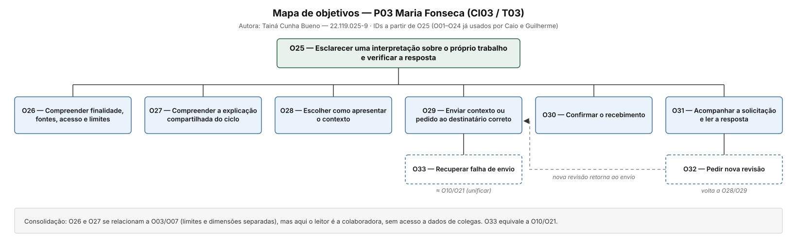

# Entrega 9 — Modelo conceitual e design centrado na comunicação

**Data:** 18/11/2026  
**Status:** 🟩 Concluida  
**Responsabilidade:** soluções individuais, com consolidação da equipe para mapa de objetivos e esquema de signos.

## Objetivo da atividade

Passar do cenário de problema para uma concepção da interação, explicitando objetivos, tópicos de conversa, falas e signos que a interface deverá comunicar/manipular.

## Transformando resultados técnicos em conceitos compreensíveis

Em TCCs algorítmicos ou orientados a dados, esta entrega deve evitar que a interface exponha apenas estruturas internas do código. Identifique os **conceitos e signos que fazem sentido para o usuário**.

Exemplos:

- `query plan`, custo estimado, recomendação e impacto para um DBA;
- modelo, dataset, versão, execução e métrica para engenheiro de IA;
- período, indicador, grupo, tendência e filtro para gestor/analista;
- alerta, severidade, evidência, responsável e status para analista de segurança.

Se um termo técnico for necessário, modele como será comunicado, explicado e relacionado à tarefa.

Dashboards, relatórios, filtros e CRUDs devem aparecer no modelo conceitual por meio dos **objetivos, signos e conversas** que justificam sua existência.

## 1. Cenários de interação

Para cada cenário de problema, produza uma versão em que a solução já pode ser descrita. **Destaque claramente o texto alterado** em relação ao cenário original.

### CI01 — Consultar uma análise e preparar o próximo passo de acompanhamento

**Autor(a):**  Caio Arnoni — 22.221.019-7
**Origem:** cenário problema C01, seção “Cenário refinado” da Entrega 4; também referenciado como E4-C01 nas entregas anteriores.

Durante uma semana de trabalho híbrido, Rafael Costa percebe que as mensagens de Maria Fonseca estão mais curtas e objetivas. Ele precisa entender se há alguma dificuldade de trabalho que justifique uma conversa de apoio. A conversa individual com Maria acontecerá naquela tarde, e Rafael quer se preparar sem levar uma avaliação previamente fechada. Está em casa, usando o notebook, e dispõe de vinte minutos antes de outra reunião.

**Em vez de reunir manualmente referências em diferentes ferramentas, Rafael solicita ao WorkSense a análise de Maria e informa qual período disponível deseja consultar. O sistema apresenta a identidade do caso, o período analisado, o histórico usado como referência, as fontes, a cobertura e a última atualização. Rafael confere se está consultando a pessoa e o ciclo pretendidos antes de interpretar os resultados.**

**Para o caso fictício desta narrativa, a análise tem dados suficientes e apresenta uma mudança na comunicação, enquanto os indicadores de tarefas permanecem próximos do histórico individual. O sistema mantém essas duas dimensões separadas e informa quais evidências sustentam a comparação e quais conclusões não são possíveis. Rafael reconhece que o andamento das entregas não explica, sozinho, o modo de escrever de Maria.**

Ele conhece os prazos, mas depende de Maria e do responsável pelo produto para compreender mudanças recentes na complexidade das demandas; os acordos de comunicação também dependem de contexto externo aos registros.

**Rafael pede esclarecimentos sobre o significado da sinalização. O sistema explica que ela representa uma alteração observada nos dados, não um diagnóstico ou uma explicação de sua causa. Uma mensagem técnica detalhada enviada por Maria contraria a impressão de respostas sempre curtas. Rafael considera esse exemplo na própria interpretação, sem presumir que ele já foi incorporado à análise: confere a atualização e reconhece a diferença entre o resultado disponível e o contexto posterior.**

Uma solicitação de alinhamento interrompe a consulta. **Ao retornar à atividade na mesma sessão, Rafael encontra preservados o caso e o período consultados e consegue retomar a análise sem reconstruir toda a sequência.**

**Rafael decide preparar uma conversa de apoio, sem concluir que Maria tenha um problema de saúde ou de desempenho. Informa esse encaminhamento, uma justificativa limitada ao contexto de trabalho, o responsável e uma data de retomada. O sistema apresenta o conteúdo a ser registrado, vinculado à colaboradora e ao período. Rafael confere e confirma o registro.**

**Após concluir o registro, o sistema confirma o resultado e devolve o caso, o período e o encaminhamento registrado para conferência. Rafael encerra a preparação sabendo o que pretende conversar e como retomar o acompanhamento. A conversa com Maria e seus resultados permanecem fora de T01 e ainda não ocorreram nesta narrativa.**

**Se a análise não tiver dados suficientes, o sistema informa a fonte ou período com cobertura insuficiente e não apresenta uma conclusão sobre mudança. Rafael pode registrar a insuficiência, indicar quem retomará a consulta e quando, mantendo qualquer conversa humana independente de uma conclusão não sustentada pelos dados.**

**Se o registro não puder ser concluído, o sistema informa que ele não foi salvo e preserva o conteúdo durante a tentativa de recuperação. Rafael pode corrigir um dado inválido ou tentar novamente, conforme a causa informada. A atividade só é considerada concluída após a confirmação; persistindo a falha, permanece pendente.**

### Diferenças relevantes

| Alteração | Por que foi necessária | Evidência/artefato que justifica |
|---|---|---|
| Consulta identificada por colaborador, período, referência, cobertura e atualização | Reduzir ambiguidade e permitir verificar se os dados são pertinentes antes de interpretar | C01.Q4–Q5; HTA T01, etapas 1 e 2.1 |
| Comunicação e tarefas interpretadas separadamente | Evitar que cumprimento de prazos seja tratado como explicação da comunicação | C01.Q6; necessidade N01; HTA T01, etapa 2.2 |
| Explicação do significado e dos limites da sinalização | Distinguir resultado técnico, contexto externo e decisão humana | C01.Q3 e Q7; necessidades N02 e N03; metas qualitativas da Entrega 8 |
| Retomada do caso e período durante a sessão | Reduzir retrabalho após interrupção | C01.Q2; contexto proposto na Entrega 3 |
| Registro justificado e confirmação vinculados ao caso | Preservar o próximo passo sem confundir planejamento com conversa já realizada | C01.Q8; HTA T01, etapas 3.1 e 3.2; necessidade N06 |
| Caminhos de insuficiência e falha explícitos | Evitar conclusão sem evidências ou impressão de salvamento não ocorrido | HTA T01, planos condicionais e repetição; Entregas 6 e 8 |

## 2. Design centrado na comunicação

**Nome do cenário:** CI01 — Consultar uma análise e preparar o próximo passo de acompanhamento.

| Tópico > subtópico | Falas e signos envolvidos | Intenção/efeito esperado |
|---|---|---|
| Consultar uma análise e registrar o próximo passo humano | `U: Quero compreender este caso e preparar um acompanhamento.` / `D: Posso apresentar as evidências disponíveis e registrar sua decisão, sem determinar a causa da mudança.` Signos: análise, colaborador, encaminhamento | Comunicar a finalidade e o limite do apoio oferecido |
| > Localizar a análise | `U: Quero consultar Maria neste período.` / `D: Este é o caso, o período analisado e o padrão individual de referência.` Signos: colaborador, período analisado, período de referência | Estabelecer o contexto correto antes da interpretação |
| > Conferir suficiência e atualização | `U: Os dados permitem essa comparação?` / `D: Estas são as fontes, a cobertura, a atualização e as limitações.` Signos: fontes, cobertura, última atualização, estado da análise | Permitir avaliar a validade da consulta |
| > Interpretar evidências | `U: O que mudou em relação ao histórico da própria pessoa?` / `D: A comunicação apresentou mudança; os indicadores de tarefas permaneceram próximos do histórico neste exemplo.` Signos: padrão individual de referência, evidências de comunicação, evidências de tarefas | Evitar que um eixo substitua o outro |
| > Compreender o significado | `U: Essa mudança explica o que está acontecendo com Maria?` / `D: Não. A sinalização não determina causa; é necessário considerar o contexto e ouvir a colaboradora.` Signos: sinalização, limites da análise | Evitar interpretações diagnósticas ou punitivas |
| > Retomar a consulta | `U: Quero continuar de onde parei.` / `D: Você estava consultando este caso e este período nesta sessão.` Signos: colaborador, período analisado | Recuperar o contexto sem perder a identidade do caso |
| > Definir próximo passo | `U: Pretendo conversar para compreender o contexto de trabalho.` / `D: Qual encaminhamento deseja registrar, por qual motivo e com quem ficará a retomada?` Signos: encaminhamento, justificativa, responsável, data de retomada | Separar decisão humana de resultado técnico |
| > Registrar insuficiência | `U: Não há dados suficientes para concluir; quero registrar essa limitação.` / `D: Posso registrar a pendência e quem retomará a consulta, sem atribuir uma conclusão à pessoa.` Signos: estado da análise, limites da análise, encaminhamento, responsável | Tornar a insuficiência um resultado válido da tarefa |
| > Conferir e concluir o registro | `U: Os dados conferem; confirmo o registro.` / `D: O registro foi concluído para este colaborador e período, com este encaminhamento.` Signos: estado do registro e conteúdo do encaminhamento | Tornar a consequência da confirmação verificável |
| > Recuperar falha de registro | `D: Não foi possível salvar; o registro continua pendente e seu conteúdo foi preservado nesta tentativa.` / `U: Quero corrigir o problema ou tentar novamente.` Signos: estado do registro, motivo da falha, campos do encaminhamento | Evitar perda de conteúdo e falsa confirmação de sucesso |

**Convenção:** `U` = usuário; `D` = preposto do designer/sistema, conforme a abordagem de Engenharia Semiótica adotada na disciplina.

## 3. Mapa de objetivos

Cada integrante apresenta seu mapa e a equipe cria um **mapa consolidado**, eliminando duplicidades e resolvendo conflitos de nomenclatura.

### Dicionário de objetivos

| ID | Objetivo | Persona(s) | Cenário(s) | Prioridade |
|---|---|---|---|---|
| O01 | Consultar uma análise e registrar o próximo passo humano | P01 — Rafael Costa | CI01 / T01 | Alta |
| O02 | Localizar a análise pertinente | P01 — Rafael Costa | CI01 | Alta |
| O03 | Avaliar as evidências e seus limites | P01 — Rafael Costa | CI01 | Alta |
| O04 | Definir o próximo passo humano | P01 — Rafael Costa | CI01 | Alta |
| O05 | Registrar e conferir o encaminhamento | P01 — Rafael Costa | CI01 | Alta |
| O06 | Conferir identidade, períodos, cobertura e atualização | P01 — Rafael Costa | CI01 | Alta |
| O07 | Interpretar comunicação e tarefas separadamente | P01 — Rafael Costa | CI01 | Alta |
| O08 | Reconhecer insuficiência de dados | P01 — Rafael Costa | CI01, alternativa de insuficiência | Alta |
| O09 | Retomar a consulta após interrupção | P01 — Rafael Costa | CI01 | Média |
| O10 | Recuperar uma falha de registro | P01 — Rafael Costa | CI01, alternativa de falha | Alta |

## 4. Esquema conceitual de signos

Consolide as informações em **uma tabela única**.

| Grupo | Signo | Origem | Observações/semântica | Tipo de conteúdo | Restrição | Valor padrão | Prevenção | Recuperação |
|---|---|---|---|---|---|---|---|---|
| Contexto | Colaborador | Domínio | Pessoa acompanhada; usuário seleciona entre identidades disponibilizadas pelo sistema | Identificador e nome de exibição | Deve pertencer ao conjunto autorizado; manter vínculo inequívoco mesmo com iniciais | Nenhum caso selecionado | PP: apresentar identidade junto ao período; PA: impedir acesso não autorizado | RA: permitir corrigir a seleção; CE: orientar contato com responsável quando faltar autorização legítima |
| Contexto | Período analisado | Domínio | Intervalo de registros sobre o qual o sistema apresenta a análise, escolhido entre os disponíveis | Intervalo de datas | Início não posterior ao fim; vinculado ao caso e à análise disponível | Nenhum até selecionar a análise | PP: explicitar datas; PA: não aceitar intervalo inexistente como análise pronta | RA: indicar períodos disponíveis e permitir nova escolha |
| Contexto | Período de referência | Aplicação | Intervalo histórico usado pelo sistema para estabelecer o padrão individual | Intervalo de datas | Corresponder à comparação efetivamente realizada; não confundir com período analisado | O da análise selecionada | PP: distinguir referência de período analisado | RA: informar ausência de referência válida e impedir conclusão indevida |
| Evidências | Padrão individual de referência | Aplicação | Síntese calculada do histórico do próprio colaborador; não representa padrão ideal nem média da equipe | Conjunto de medidas com unidades e explicação | Depende de histórico suficiente; não comparar pessoas como equivalentes | Não disponível até haver referência válida | PP: explicar comparação consigo mesmo | RA: informar insuficiência e permitir registrar pendência |
| Evidências | Fontes | Domínio | Origem dos registros profissionais ou comunicacionais apresentada pelo sistema | Conjunto de nomes de fontes | Indicar apenas fontes realmente consideradas na análise | Fontes da análise selecionada | PP: explicar o que cada fonte representa | CE: se uma integração exigir reparo externo, indicar responsável técnico sem atribuir a falha ao colaborador |
| Evidências | Cobertura | Aplicação | Disponibilidade dos dados por fonte e período, produzida pelo sistema | Estado por fonte e intervalo; contagem quando conhecida | Não apresentar percentual sem denominador; desconhecido não equivale a completo | Não verificada | PP: informar lacunas e alcance da comparação | RA: permitir registrar insuficiência; CE: indicar reparo externo quando necessário |
| Evidências | Última atualização | Aplicação | Momento da atualização dos dados considerados na análise | Data e hora com referência de fuso | Não apresentar horário de consulta como se fosse atualização dos dados | Não disponível até conhecer a atualização | PP: identificar a que atualização o horário se refere | RA: sinalizar indisponibilidade ou desatualização sem inventar horário |
| Evidências | Estado da análise | Aplicação | Situação da produção ou disponibilidade da análise, não avaliação da pessoa | Categoria: em processamento, disponível, incompleta ou indisponível | Usar conforme a cobertura e o processamento; não equivale a sinalização | Indisponível até confirmação | PP: explicar cada estado; PA: não emitir conclusão para dados insuficientes | RA: aguardar ou registrar pendência; CE: orientar suporte em falha não recuperável pelo gestor |
| Evidências | Evidências de comunicação | Aplicação | Indicadores derivados de registros comunicacionais, apresentados pelo sistema em relação à referência | Medidas e comparação explicadas | Exibir unidades e período; sem inferir diagnóstico ou causa; limitar dados identificáveis | Não disponíveis sem dados suficientes | PP: explicar limites e manter separado das tarefas | RA: indicar insuficiência ou informação divergente a conferir |
| Evidências | Evidências de tarefas | Aplicação | Indicadores derivados dos registros de trabalho, separados dos comunicacionais | Medidas e comparação explicadas | Não equivalem a desempenho global; dependem de cobertura suficiente | Não disponíveis sem dados suficientes | PP: explicitar alcance das medidas | RA: indicar limitações e permitir manter pendência |
| Interpretação | Sinalização | Aplicação | Resultado derivado de alteração em uma dimensão; não decisão sobre a pessoa | Classificação por dimensão e explicação | Só concluir com dados suficientes; ausência de sinalização não significa ausência de dificuldade humana | Sem conclusão até verificar suficiência | PP: distinguir alteração, causa e decisão | RA: consultar evidências e limites antes de registrar |
| Interpretação | Limites da análise | Aplicação | Explicação do que os resultados permitem ou não concluir, produzida pelo sistema | Texto contextual | Vinculado ao caso e às limitações reais; não esconder ausência de dados | Explicação geral, acrescida das limitações do caso | PP: tornar explícitas as restrições de interpretação | RA: oferecer explicação complementar; sem prometer esclarecer a causa humana |
| Encaminhamento | Encaminhamento | Domínio | Próximo passo escolhido por Rafael, independente de automatismos do modelo | Categoria: conversar, acompanhar, não intervir neste ciclo ou aguardar dados | Seleção explícita; insuficiência não fundamenta uma conclusão sobre a pessoa | Nenhum | PP: explicar opções; PA: exigir escolha; AL: pedir revisão se houver insuficiência e conclusão incompatível | RA: permitir revisar antes de confirmar |
| Encaminhamento | Justificativa | Domínio | Motivo informado por Rafael; distinguir evidência, hipótese e informação a confirmar | Texto | Obrigatória para registrar; sem diagnósticos ou conteúdo pessoal desnecessário | Vazia | PP: orientar conteúdo mínimo; PA: impedir confirmação vazia | RA: identificar ausência e preservar os demais dados |
| Encaminhamento | Responsável pela retomada | Domínio | Pessoa autorizada indicada para dar continuidade | Referência a pessoa autorizada | Obrigatória para registro; não escolher terceiro sem responsabilidade definida | Nenhum | PP: explicar responsabilidade; PA: exigir indicação válida | RA: corrigir responsável sem perder justificativa |
| Encaminhamento | Data de retomada | Domínio | Data proposta pelo usuário para reavaliar o encaminhamento | Data | Obrigatória para acompanhar ou aguardar dados; não anterior à data do registro | Não definida | PP: explicar formato e quando é necessária; PA: validar condição e data | RA: indicar o problema e permitir corrigir |
| Registro | Estado do registro | Aplicação | Situação do encaminhamento durante a interação | Categoria: rascunho, salvando, salvo ou falha | Informar salvo somente após conclusão confirmada; simulação declarada no protótipo | Rascunho | PP: distinguir rascunho de salvo; AL: avisar antes de descartar conteúdo | RA: preservar conteúdo e tentar novamente; manter pendência se não salvar |
| Registro | Motivo da falha | Aplicação | Explicação produzida pelo sistema sobre o impedimento e a ação possível | Texto contextual | Não expor detalhes técnicos ou credenciais; não afirmar causa desconhecida | Não se aplica sem falha | PP: explicar restrições conhecidas antes da confirmação | RA: orientar correção ou nova tentativa; CE: indicar suporte se a recuperação estiver fora da interface |
| Transparência | Finalidade da análise | Aplicação | Para que a análise existe e o que ela compara (próprio histórico, não colegas) | Texto fixo | Não prometer usos não previstos; não sugerir avaliação | — | Exibir antes da primeira explicação | — |
| Transparência | Acesso aos resultados | Domínio | Quem vê a análise da colaboradora e em que nível de detalhe | Lista de papéis e pessoas | Coerente com a política de acesso definida | Gestor responsável | Indicar que colegas não têm acesso | — |
| Explicação | Explicação compartilhada | Aplicação | Versão da análise do ciclo que o gestor compartilhou com a colaboradora | Período, dimensões, limites, autor e data do compartilhamento | Só a própria colaboradora; sem dados de colegas | — | Informar “nenhuma explicação compartilhada” quando ausente | Permitir pergunta geral ao gestor |
| Esclarecimento | Forma de contato | Domínio | Como a colaboradora quer apresentar o contexto | Categoria: mensagem escrita ou conversa reservada | Uma opção por solicitação | Mensagem escrita | Mostrar a alternativa de conversa ao lado | Trocar antes de enviar |
| Esclarecimento | Tipo de solicitação | Domínio | Natureza do que é enviado | Categoria: pergunta, correção de informação ou contexto | Obrigatório na mensagem escrita | — | Rótulos com exemplo curto | Alterar antes de enviar |
| Esclarecimento | Mensagem de contexto | Domínio | Texto livre escrito pela colaboradora | Texto, até 1000 caracteres | Obrigatória na mensagem escrita; não exigir justificativa pessoal | Vazio | Aviso sobre dados de saúde ou pessoais sensíveis | Texto preservado na falha; alerta antes de descartar |
| Esclarecimento | Destinatário | Domínio | Pessoa que recebe a solicitação | Nome e papel | Gestor responsável pela equipe da colaboradora | Gestor responsável | Exibido antes do envio | — |
| Acompanhamento | Estado da solicitação | Aplicação | Situação do pedido desde o envio | Categoria: rascunho, enviando, recebida, em análise, respondida, esclarecida, falha | Informar “recebida” só após confirmação | Rascunho | Linha do tempo com datas | Em falha: tentar novamente sem perder o texto |
| Acompanhamento | Resposta | Domínio | Retorno escrito do gestor à solicitação | Texto com autor e data | Visível só para a colaboradora e o autor | — | — | Pedir nova revisão vinculada |

### Regras para os signos

- Use o vocabulário do domínio do usuário.
- Evite duplicar o mesmo conceito com nomes diferentes.
- Diferencie informação fornecida pelo usuário, produzida pelo sistema e derivada do domínio.
- Registre prevenção e recuperação apenas quando fizer sentido; explique as siglas usadas.
- **Signos reaproveitados no CI03 (Tainá):** período analisado, período de referência, fontes, evidências de comunicação, evidências de tarefas, sinalização e limites da análise mantêm o mesmo nome e significado do esquema do Caio. No CI03, o colaborador é sempre a própria usuária, e não um campo de seleção.
- **Motivo da falha** é reaproveitado do registro de T01, aplicado ao envio da solicitação.

## 1. Cenários de interação

### CI02 — Fazer uma triagem rápida da equipe e registrar o encaminhamento

**Autor(a):** Guilherme Matias — 22.122.071-8  
**Origem:** cenário problema C02, seção “Cenário refinado” da Entrega 4; tarefa T02 (HTA, GOMS e CTT da Entrega 5).

Em uma semana de trabalho presencial e híbrido, João Pedro percebe que as mensagens de Camila Duarte estão mais secas e que ela participa menos das conversas informais. Ele precisa decidir se isso merece uma conversa de apoio. A reunião individual mensal já está marcada para o dia seguinte, e João quer chegar com uma ideia clara do que perguntar, sem uma conclusão fechada. Ele está em uma sala compartilhada, com quinze minutos entre duas reuniões, e evita deixar nomes e mensagens abertos na tela.

**Em vez de abrir planilha de escalas, sistema de chamados e chat para comparar tudo manualmente, João abre o painel do WorkSense. O sistema apresenta primeiro um resumo da equipe em linguagem simples, informando se há alguma situação a observar. As pessoas aparecem de forma discreta, por iniciais, para que ninguém por perto leia nomes na tela. Para este caso fictício, o resumo indica uma situação a observar: uma mudança na comunicação de C. D. em relação ao histórico da própria colaboradora.**

**João lê, junto da sinalização, um texto curto que explica o que ela significa e o que não significa: é uma alteração observada nos dados, não um diagnóstico, uma avaliação da pessoa ou uma explicação da causa. Ele decide se precisa aprofundar. Se considerar a variação pequena e a explicação suficiente, pode ir direto ao registro de “acompanhar” ou “não intervir”.**

Os chamados de Camila parecem fechados dentro das metas, mas João não sabe se isso explica ou não a mudança no modo de escrever. **Ao aprofundar, o sistema mostra os períodos de referência e de reanálise com datas explícitas, a última atualização, a cobertura dos dados e o estado da análise. Os indicadores de comunicação e os de trabalho aparecem separados, com uma explicação curta de qual deles mudou. João vê que a comunicação mudou e que os indicadores de trabalho permanecem próximos do histórico, e entende que o cumprimento das metas não explica sozinho a mudança. Se algum termo não for claro (como “referência” ou “variação”), ele abre uma explicação em linguagem simples e volta ao resumo. Detalhes técnicos só aparecem se ele os pedir.**

João depende do supervisor para saber que as últimas duas semanas tiveram pico de demanda e troca de turnos, informação que não consta nas ferramentas. **O sistema lembra que o sinal não substitui a conversa com a pessoa. O contexto externo e a conversa com Camila ficam fora do sistema e ainda não ocorreram nesta narrativa.**

Um supervisor o chama para resolver uma escala. **Ao voltar, na mesma sessão, João encontra preservados a pessoa, o período e a etapa em que estava, sem recomeçar a consulta.**

**João escolhe o encaminhamento “acompanhar”, escreve uma justificativa curta limitada ao contexto de trabalho e indica a data de retomada. O sistema apresenta o conteúdo a ser registrado, vinculado ao colaborador e ao período. João confere e confirma. O sistema informa que o registro foi salvo e devolve pessoa, período e encaminhamento para conferência. João encerra a consulta sabendo o que pretende perguntar e quando retomar o assunto.**

**Se a análise estiver sem dados, incompleta ou com evidência insuficiente, o sistema informa qual fonte ou período falhou, não apresenta conclusão sobre mudança e só permite registrar “aguardar dados”, com justificativa curta. João pode manter a conversa humana prevista, independentemente de uma conclusão que os dados não sustentam.**

**Se o registro não puder ser salvo, o sistema informa que ele não foi salvo e preserva o conteúdo digitado. João pode corrigir um dado inválido ou tentar novamente. A atividade só é considerada concluída após a confirmação.**

### Diferenças relevantes
| Alteração | Por que foi necessária | Evidência/artefato que justifica |
|---|---|---|
| Resumo da equipe em linguagem simples na abertura, com identificação discreta | João tem quinze minutos, pouca familiaridade com métricas e outras pessoas por perto | C02.Q2; persona P02; HTA T02, etapa 1; CT01 da Entrega 3 |
| Texto “o que o sinal significa e não significa” junto da sinalização | Evitar que o sinal seja lido como diagnóstico ou veredito, o medo central de João | Persona P02; H17 e H25; HTA T02, etapa 2.1 |
| Aprofundamento opcional, com caminho curto até o registro | A triagem rápida só aprofunda se a situação parecer relevante | C02.Q1 e Q6; GOMS T02 (M1 e SR1) |
| Confiabilidade explícita: períodos, atualização, cobertura e estado da análise | João teme agir com dado incompleto e prejudicar alguém | C02.Q5; HTA T02, etapa 3.1; RC10 |
| Comunicação e indicadores de trabalho separados, com explicação resumida | “Meta cumprida” não responde à pergunta sobre comunicação | C02.Q6; HTA T02, etapa 3.2; RC06 |
| Explicação de termos sob demanda | O vocabulário (baseline, variação, sinalização) é lacuna ?03 e João não é analítico | Entrega 1 (?03); Entrega 7 (Bloco 4); HTA T02, etapa 3.3 |
| Lembrete de que a conversa humana vem antes da ação | O contexto externo não está nos registros e depende de supervisor e conversa | C02.Q3 e Q8; HTA T02, etapa 4 |
| Retomada da consulta na mesma sessão | João é interrompido por supervisores | C02.Q2; GOMS T02 (M4 e SR5); estado E04 |
| Registro com encaminhamento, justificativa, confirmação e caminho de falha | João precisa de respaldo documentado e de saber se o registro foi salvo | C02.Q8; HTA T02, etapa 5; estados P06, P07 e E02 |
| Caminho de análise não confiável (“aguardar dados”) | Dado insuficiente não pode virar conclusão sobre a pessoa | GOMS T02 (M3 e SR2); estado E03 |

## 2. Design centrado na comunicação

**Nome do cenário:** CI02 — Fazer uma triagem rápida da equipe e registrar o encaminhamento.

| Tópico > subtópico | Falas e signos envolvidos | Intenção/efeito esperado |
|---|---|---|
| Fazer a triagem da equipe e registrar o encaminhamento | `U: Preciso saber se devo me preocupar com alguém da equipe.` / `D: Posso resumir o que mudou nos dados e registrar sua decisão, sem avaliar ninguém nem dizer o motivo da mudança.` Signos: resumo da equipe, sinalização, encaminhamento | Comunicar a finalidade e o limite do apoio |
| > Obter a leitura inicial | `U: Tem algo que eu precise olhar agora?` / `D: Há 1 situação a observar (C. D.).` ou `D: Nenhuma situação a observar nos dados disponíveis.` Signos: resumo da equipe, sinalização, identificação discreta | Dar uma resposta simples em poucos segundos, sem expor nomes |
| > Entender o significado do sinal | `U: Isso é grave?` / `D: É uma mudança em relação ao histórico da própria pessoa. Não é diagnóstico nem explica a causa. Vale conversar antes de agir.` Signos: sinalização, limites da análise | Evitar leitura diagnóstica ou punitiva |
| > Decidir se aprofunda | `U: Quero ver mais detalhes.` ou `U: Não preciso aprofundar.` / `D: Posso mostrar a confiabilidade e a explicação, ou ir direto ao registro.` Signos: sinalização, encaminhamento | Tornar o aprofundamento opcional |
| > Conferir a confiabilidade | `U: Posso confiar nesses dados?` / `D: Referência: 30 dias. Reanálise: 15 dias. Atualizado em [data]. Análise: completa.` Signos: período de referência, período analisado, última atualização, cobertura, estado da análise | Permitir avaliar a validade antes de agir |
| > Entender o que mudou | `U: O que mudou?` / `D: A comunicação mudou em relação ao histórico dela. Os indicadores de trabalho ficaram próximos do histórico.` Signos: dimensão alterada, explicação resumida, evidências de comunicação, evidências de trabalho | Evitar que uma dimensão substitua a outra |
| > Consultar um termo | `U: O que significa “variação”?` / `D: É a diferença entre o período atual e o histórico da própria pessoa.` Signos: termo de ajuda | Reduzir a barreira de vocabulário sem exigir conhecimento técnico |
| > Reconhecer análise não confiável | `D: Não há dados suficientes para concluir se houve mudança (fonte: chat, últimos 15 dias).` / `U: Entendi; vou aguardar.` Signos: estado da análise, cobertura, limites da análise | Impedir ação sobre análise inexistente |
| > Considerar o contexto humano | `D: Este sinal não substitui a conversa. Converse com a pessoa antes de decidir.` / `U: Vou conversar com ela amanhã.` Signos: lembrete de conversa humana, limites da análise | Reforçar a decisão humana fora do sistema |
| > Retomar após interrupção | `U: Quero continuar de onde parei.` / `D: Você estava vendo C. D., no período de [datas], na etapa de confiabilidade.` Signos: colaborador, período analisado, etapa | Recuperar o contexto sem recomeçar |
| > Registrar o encaminhamento | `U: Quero registrar o que decidi.` / `D: Qual encaminhamento (apoiar, acompanhar, não intervir ou aguardar dados) e por quê?` Signos: encaminhamento, justificativa, data de retomada | Separar decisão humana de resultado técnico |
| > Conferir e concluir | `D: Você vai registrar “acompanhar” para C. D., período [datas]. Confirmar?` / `U: Confirmo.` / `D: Registro salvo.` Signos: encaminhamento, estado do registro | Tornar a consequência da confirmação verificável |
| > Recuperar falha de registro | `D: Não foi possível salvar. Seu texto foi mantido. Tente novamente.` / `U: Quero tentar de novo.` Signos: estado do registro, motivo da falha | Evitar perda de conteúdo e falsa confirmação |

**Convenção:** `U` = usuário; `D` = preposto do designer/sistema, conforme a abordagem de Engenharia Semiótica adotada na disciplina.

## 3. Mapa de objetivos

### Dicionário de objetivos

| ID | Objetivo | Persona(s) | Cenário(s) | Prioridade | Equivalente no mapa do Caio |
|---|---|---|---|---|---|
| O11 | Fazer a triagem da equipe e registrar o encaminhamento | P02 — João Pedro | CI02 / T02 | Alta | O01 |
| O12 | Obter a leitura inicial da equipe em linguagem simples | P02 — João Pedro | CI02 | Alta | O02 (parcial) |
| O13 | Decidir se vale aprofundar | P02 — João Pedro | CI02 | Alta | — (novo) |
| O14 | Verificar a confiabilidade da análise | P02 — João Pedro | CI02 | Alta | O06 |
| O15 | Entender o que mudou em cada dimensão | P02 — João Pedro | CI02 | Alta | O07 |
| O16 | Consultar o significado dos termos e do sinal | P02 — João Pedro | CI02 | Média | O03 (parcial) |
| O17 | Reconhecer análise não confiável e aguardar dados | P02 — João Pedro | CI02, alternativa de insuficiência | Alta | O08 |
| O18 | Considerar o contexto humano antes de agir | P02 — João Pedro | CI02 | Alta | O04 |
| O19 | Registrar e conferir o encaminhamento | P02 — João Pedro | CI02 | Alta | O05 |
| O20 | Retomar a consulta após interrupção | P02 — João Pedro | CI02 | Média | O09 |
| O21 | Recuperar uma falha de registro | P02 — João Pedro | CI02, alternativa de falha | Alta | O10 |

## 4. Esquema conceitual de signos

| Grupo | Signo | Origem | Observações/semântica | Tipo de conteúdo | Restrição | Valor padrão | Prevenção | Recuperação |
|---|---|---|---|---|---|---|---|---|
| Leitura inicial | Resumo da equipe | Aplicação | Mensagem curta que informa se há ou não situação a observar; não classifica pessoas | Texto curto e contagem de situações | Não usar rótulos como “em risco”, “improdutivo” ou “problema”; não exibir ranking | “Nenhuma situação a observar nos dados disponíveis” só quando a análise estiver completa | PP: usar linguagem simples; PA: não emitir “nenhuma situação” se a análise estiver incompleta | RA: indicar que a análise não está completa e levar à confiabilidade |
| Leitura inicial | Identificação discreta | Aplicação | Forma reduzida de identificar o colaborador na tela (iniciais), pensada para sala compartilhada | Iniciais | Inequívoca entre os colaboradores da equipe; nome completo só sob demanda | Iniciais | PP: explicar que a tela evita exibir nomes; PA: não incluir nome em notificações | RA: permitir ver o nome completo ao selecionar a pessoa |
| Contexto | Colaborador | Domínio | Pessoa acompanhada; escolhida pelo gestor entre as autorizadas | Identificador e nome de exibição | Deve pertencer à equipe do gestor | Nenhum | PP: mostrar a pessoa junto do período; PA: impedir acesso fora da equipe | RA: permitir corrigir a seleção |
| Contexto | Período analisado | Domínio | Intervalo recente (reanálise de 15 dias) sobre o qual o sistema apresenta a análise | Intervalo de datas | Início não posterior ao fim; vinculado ao colaborador | Último ciclo disponível | PP: mostrar datas explícitas | RA: indicar períodos disponíveis |
| Contexto | Período de referência | Aplicação | Intervalo histórico (30 dias) usado como padrão individual de comparação | Intervalo de datas | Não confundir com o período analisado | O da análise selecionada | PP: distinguir referência de período analisado | RA: informar ausência de referência válida e impedir conclusão |
| Interpretação | Sinalização | Aplicação | Alteração observada em relação ao histórico da própria pessoa; não é decisão nem avaliação | Indicação por dimensão e explicação curta | Só emitir com dados suficientes; ausência de sinal não significa ausência de dificuldade humana | Sem conclusão até verificar a suficiência | PP: explicar o que é e o que não é; PA: não emitir se os dados forem insuficientes | RA: levar às evidências e aos limites antes do registro |
| Interpretação | Limites da análise | Aplicação | Texto que explica o que o resultado permite e não permite concluir | Texto contextual | Vinculado ao caso; não esconder ausência de dados | Explicação geral, mais as limitações do caso | PP: exibir junto da sinalização | RA: oferecer explicação complementar |
| Interpretação | Dimensão alterada | Aplicação | Indica se a mudança foi na comunicação ou nos indicadores de trabalho, mantidas separadas | Categoria: comunicação ou trabalho | Nunca combinar em um único valor | Nenhuma | PP: nomear as dimensões em linguagem do gestor | RA: permitir ver cada dimensão isoladamente |
| Interpretação | Explicação resumida | Aplicação | Frase que informa qual dimensão mudou, sem termos técnicos e sem sugerir causa | Texto curto | Sem diagnóstico, causa ou julgamento | Não disponível sem dados suficientes | PP: usar vocabulário do gestor | RA: oferecer detalhes opcionais |
| Interpretação | Evidências de comunicação e de trabalho | Aplicação | Indicadores por dimensão, apresentados só no aprofundamento | Medidas com unidade e comparação | Exibir período; não equivalem a desempenho global | Ocultas na primeira camada | PP: mostrar só sob demanda (“ver detalhes”) | RA: permitir voltar ao resumo |
| Interpretação | Termo de ajuda | Aplicação | Explicação curta de um conceito (referência, variação, sinalização) | Texto curto | Linguagem simples, sem fórmulas | Não exibido até ser solicitado | PP: marcar termos com ajuda disponível | RA: permitir voltar ao ponto em que estava |
| Confiabilidade | Última atualização | Aplicação | Momento da atualização dos dados considerados | Data e hora | Não confundir com o horário da consulta | Não disponível até conhecer a atualização | PP: dizer a que se refere a data | RA: sinalizar desatualização sem inventar horário |
| Confiabilidade | Cobertura | Aplicação | Disponibilidade dos dados por fonte e período | Estado por fonte | Desconhecido não equivale a completo | Não verificada | PP: informar lacunas | RA: permitir registrar “aguardar dados”; CE: indicar reparo externo quando necessário |
| Confiabilidade | Estado da análise | Aplicação | Situação da análise: completa, sem dados, incompleta ou insuficiente; não avalia a pessoa | Categoria | Distinguir visual e textualmente “sem alteração relevante” de “sem dados” | Indisponível até confirmação | PP: explicar cada estado; PA: não emitir conclusão em análise não confiável | RA: aguardar ou registrar pendência; CE: orientar suporte em falha de integração |
| Contexto humano | Lembrete de conversa humana | Aplicação | Aviso de que o sinal não substitui a conversa com a pessoa antes de qualquer ação | Texto curto | Presente sempre que houver sinalização | Exibido com a sinalização | PP: reforçar o limite da ferramenta | — |
| Encaminhamento | Encaminhamento | Domínio | Próximo passo escolhido por João, sem automatismo do sistema | Categoria: apoiar, acompanhar, não intervir ou aguardar dados | Seleção explícita; com análise não confiável só “aguardar dados” | Nenhum (E03: “aguardar dados” pré-selecionado) | PP: explicar as opções; PA: exigir escolha; AL: alertar sobre escolha incompatível com análise insuficiente | RA: permitir revisar antes de confirmar |
| Encaminhamento | Justificativa | Domínio | Motivo informado por João, em linguagem natural | Texto livre curto | Obrigatória para apoiar ou acompanhar; sem diagnóstico nem dado pessoal desnecessário | Vazia (curta ou predefinida em “não intervir” e “aguardar dados”) | PP: orientar o conteúdo mínimo; PA: impedir confirmação vazia quando obrigatória | RA: apontar a ausência e preservar os demais dados |
| Encaminhamento | Data de retomada | Domínio | Data proposta para rever o encaminhamento | Data | Obrigatória para acompanhar ou aguardar dados; não anterior ao registro | Não definida | PP: explicar quando é necessária; PA: validar a data | RA: indicar o problema e permitir corrigir |
| Registro | Estado do registro | Aplicação | Situação do encaminhamento durante a interação | Categoria: rascunho, salvando, salvo ou falha | Informar “salvo” somente após conclusão confirmada; no protótipo, a simulação é declarada | Rascunho | PP: distinguir rascunho de salvo; AL: avisar antes de descartar conteúdo | RA: preservar o conteúdo e permitir tentar novamente |
| Registro | Motivo da falha | Aplicação | Explicação do impedimento e da ação possível | Texto contextual | Sem detalhes técnicos | Não se aplica sem falha | PP: explicar restrições conhecidas antes da confirmação | RA: orientar correção ou nova tentativa; CE: indicar suporte se a recuperação estiver fora da interface |

### Regras para os signos

- **Siglas:** PP = prevenção passiva (informar antes de o erro ocorrer); PA = prevenção ativa (impedir a ação inválida); AL = alerta (avisar antes de uma ação de risco); RA = recuperação apoiada (o sistema ajuda a corrigir); CE = contato externo (a solução depende de outra pessoa ou serviço).
- **Origem:** *Domínio* = informação do mundo do gestor (colaborador, encaminhamento); *Aplicação* = produzida pelo sistema (estado da análise, sinalização).
- Os signos Colaborador, Período analisado, Período de referência, Sinalização, Limites da análise, Estado da análise, Última atualização, Cobertura, Encaminhamento, Justificativa, Data de retomada, Estado do registro e Motivo da falha têm o mesmo nome e significado do esquema do Caio, para a consolidação.

## 1. Cenários de interação

### CI03 — Esclarecer uma interpretação e acompanhar a resposta

**Autor(a):** Tainá Cunha Bueno — 22.119.025-9
**Origem:** cenário problema C03, seção “Cenário refinado” da Entrega 4; tarefa T03 (HTA, GOMS e CTT da Entrega 5).

No fim de uma conversa individual, Rafael Costa comenta com Maria Fonseca que as mensagens dela no chat da equipe têm parecido mais curtas e pergunta se está tudo bem. Maria se surpreende: suas tarefas estão em dia. **No dia seguinte, ela recebe um aviso de que Rafael compartilhou com ela a explicação do ciclo 22/10–05/11.** À noite, em casa, abre o notebook com cerca de meia hora disponível.

**Em vez de tentar adivinhar em que Rafael se baseou, Maria abre “Sobre minhas análises”. O sistema informa para que a análise serve, quais fontes entram (mensagens de trabalho e cartões de tarefas), que a comparação é feita com o histórico dela, e não com colegas, e quem vê os resultados. Também deixa claro o que a análise não é: diagnóstico, avaliação de desempenho ou base para punição.**

**Ela abre a explicação do ciclo. O sistema mostra o período analisado e o de referência, quem compartilhou e quando, e apresenta separadamente as duas dimensões: a comunicação mudou em relação ao histórico dela (mensagens mais frequentes e mais curtas) e as tarefas permaneceram próximas do histórico. Um bloco explica o que isso significa e o que não significa, lembrando que a análise não conhece a causa da mudança.**

Parte do contexto não está nos registros: ela está mentorando dois desenvolvedores juniores, e o líder técnico pediu respostas objetivas durante a release. **Maria escolhe “Esclarecer ou adicionar contexto”. O sistema oferece duas formas: mensagem escrita ou pedido de conversa reservada. Ela escolhe a mensagem escrita, marca o tipo “contexto” e escreve sobre a mentoria e a release. O sistema mostra o destinatário, Rafael Costa, e o ciclo vinculado, e avisa para não incluir informações de saúde ou pessoais sensíveis.** Maria decide não mencionar um problema familiar; **o sistema não exige justificativa pessoal e informa que enviar o contexto não altera automaticamente a análise.**

**Ela envia. O sistema confirma que a solicitação foi recebida, com data, hora, destinatário e estado, e indica onde acompanhar a resposta.**

**No dia seguinte, em “Minhas solicitações”, Maria vê que o estado passou de “recebida” para “em análise” e depois para “respondida”. Lê a resposta de Rafael, que diz ter considerado a mentoria e a release e que não vê necessidade de outra ação. Maria seleciona “Considero esclarecido”. Se a resposta não considerasse o contexto, ela poderia pedir nova revisão, vinculada à mesma solicitação.**

**Se Maria preferir não escrever, pode pedir uma conversa reservada, indicando uma preferência de horário; a conversa ocorre fora do sistema, e a solicitação segue os mesmos estados.**

**Se o envio falhar, o sistema informa que nada foi enviado, mantém o texto e oferece tentar novamente. Se ela sair antes de enviar, o sistema avisa que o rascunho será descartado.**

**Se não houver explicação compartilhada no ciclo, o sistema informa isso e permite enviar uma pergunta geral ao gestor.**

### Diferenças relevantes

| Alteração | Por que foi necessária | Evidência/artefato que justifica |
|---|---|---|
| Página de transparência: finalidade, fontes, comparação com o próprio histórico e quem vê | Maria não sabia em que o comentário se baseou | C03.Q3; N07; H11 e H28; HTA T03, etapa 1.1 |
| Explicação com período, quem compartilhou e dimensões separadas | Evitar que mudança de comunicação seja lida como queda de desempenho | C03.Q3; HTA T03, etapa 1.3; persona P03 |
| Bloco “o que significa e o que não significa” | Reduzir leitura avaliativa ou diagnóstica | H25; Entrega 8, meta qualitativa de T03 |
| Escolha entre mensagem escrita e conversa reservada | Permitir dar contexto sem expor questões pessoais | C03.Q5; GOMS T03, SR2 |
| Destinatário e ciclo visíveis antes do envio; aviso sobre dados sensíveis | Saber para quem vai o contexto e evitar exposição | C03.Q5, Q7; HTA T03, etapa 2.3 |
| Aviso de que enviar não altera a análise automaticamente | Evitar expectativa falsa sobre o efeito do envio | Jornada J03 da Entrega 3 (variação essencial para teste) |
| Confirmação de recebimento e estados da solicitação | Responder à ruptura do silêncio | C03.Q7; HTA T03, etapas 3.1–3.2 |
| Encerramento decidido pela colaboradora e pedido de nova revisão | Critério de conclusão definido por ela | C03.Q8; GOMS T03, SR3 |
| Caminhos de falha, abandono e ausência de explicação | Evitar perda de texto, falsa confirmação ou beco sem saída | HTA T03, planos 1 e 2; CTT T03 (`[>`) |

## 2. Design centrado na comunicação

**Nome do cenário:** CI03 — Esclarecer uma interpretação e acompanhar a resposta.

| Tópico > subtópico | Falas e signos envolvidos | Intenção/efeito esperado |
|---|---|---|
| Esclarecer uma interpretação e verificar a resposta | `U: Quero entender o que foi observado sobre mim e explicar o meu lado.` / `D: Posso mostrar o que é analisado e a explicação do seu ciclo, e levar o seu contexto ao seu gestor. Não decido nada sobre você.` Signos: explicação compartilhada, solicitação, destinatário | Comunicar a finalidade e o limite do apoio oferecido |
| > Entender o uso dos meus dados | `U: O que é analisado e quem vê?` / `D: Mensagens de trabalho e cartões de tarefas, comparados com o seu próprio histórico. Seu gestor vê indicadores e explicações; você vê apenas a sua análise.` Signos: finalidade da análise, fontes, acesso aos resultados | Reduzir a assimetria de informação e a percepção de vigilância |
| > Consultar a explicação do ciclo | `U: O que mudou neste ciclo?` / `D: No período 22/10–05/11, sua comunicação mudou em relação ao seu histórico; suas tarefas ficaram próximas do histórico.` Signos: período analisado, período de referência, evidências de comunicação, evidências de tarefas, explicação compartilhada | Separar as dimensões e situar o período |
| > Compreender o significado | `U: Isso quer dizer que estou indo mal?` / `D: Não. É uma mudança em relação ao seu próprio padrão. Não é avaliação, diagnóstico ou punição, e a análise não sabe a causa.` Signos: sinalização, limites da análise | Evitar leitura avaliativa ou diagnóstica |
| > Sem explicação compartilhada | `D: Nenhuma explicação foi compartilhada com você neste ciclo.` / `U: Quero fazer uma pergunta ao meu gestor mesmo assim.` Signos: explicação compartilhada (ausente), destinatário | Não deixar beco sem saída |
| > Escolher como esclarecer | `D: Você pode escrever uma mensagem ou pedir uma conversa reservada.` / `U: Prefiro escrever.` ou `U: Prefiro conversar.` Signos: forma de contato | Respeitar a preferência e o nível de exposição |
| > Descrever o contexto | `U: Quero explicar que estou mentorando juniores e que a release exigiu respostas curtas.` / `D: Sua mensagem vai para Rafael Costa, vinculada ao ciclo 22/10–05/11. Não inclua informações de saúde ou pessoais sensíveis. Enviar não altera automaticamente a análise.` Signos: tipo de solicitação, mensagem de contexto, destinatário | Tornar visíveis o destino e o efeito do envio |
| > Confirmar o recebimento | `D: Sua solicitação foi recebida pelo sistema em 07/11 às 14:32 e encaminhada a Rafael Costa. Isso não significa que o gestor já leu sua mensagem. Você será avisada quando houver resposta.` Signos: estado da solicitação | Distinguir envio, recebimento e leitura |
| > Acompanhar a solicitação | `U: Já tive resposta?` / `D: Estado: respondida. Resposta de Rafael Costa em 08/11.` Signos: estado da solicitação, resposta | Responder à ruptura do silêncio |
| > Concluir ou pedir nova revisão | `U: Considero esclarecido.` ou `U: A resposta não considerou meu contexto; quero pedir nova revisão.` / `D: Sua nova mensagem será vinculada à mesma solicitação.` Signos: estado da solicitação, mensagem de contexto | A conclusão é decidida pela colaboradora |
| > Recuperar falha de envio | `D: Não foi possível enviar. Sua mensagem foi mantida; nada foi enviado ao seu gestor.` / `U: Quero tentar novamente.` Signos: estado da solicitação, motivo da falha | Evitar perda de texto e falsa confirmação |
| > Sair sem enviar | `D: Há texto ainda não enviado. Se sair, ele será descartado.` / `U: Quero continuar editando.` ou `U: Quero descartar.` Signos: mensagem de contexto | Prevenir perda acidental |

**Convenção:** `U` = usuária; `D` = preposto do designer/sistema, conforme a abordagem de Engenharia Semiótica adotada na disciplina.

## 3. Mapa de objetivos

Fonte editável: [`mapa_objetivos_p03.svg`](../assets/09_modelo_conceitual/mapa_objetivos_p03.svg)

### Dicionário de objetivos

| ID | Objetivo | Persona(s) | Cenário(s) | Prioridade | Equivalente nos mapas dos colegas |
|---|---|---|---|---|---|
| O25 | Esclarecer uma interpretação sobre o próprio trabalho e verificar a resposta | P03 — Maria Fonseca | CI03 / T03 | Alta | Novo; complementa O01/O11 do lado da colaboradora |
| O26 | Compreender finalidade, fontes, acesso e limites | P03 — Maria Fonseca | CI03 | Alta | Relacionado a O03; novo quanto a “quem acessa” |
| O27 | Compreender a explicação compartilhada do ciclo | P03 — Maria Fonseca | CI03 | Alta | Relacionado a O07/O15, com leitora diferente |
| O28 | Escolher como apresentar o contexto | P03 — Maria Fonseca | CI03 | Média | Novo |
| O29 | Enviar contexto ou pedido ao destinatário correto | P03 — Maria Fonseca | CI03 | Alta | Novo |
| O30 | Confirmar o recebimento | P03 — Maria Fonseca | CI03 | Alta | Análogo a O05/O19 (conferir resultado) |
| O31 | Acompanhar a solicitação e ler a resposta | P03 — Maria Fonseca | CI03 | Alta | Novo |
| O32 | Pedir nova revisão | P03 — Maria Fonseca | CI03, alternativa | Média | Novo |
| O33 | Recuperar falha de envio | P03 — Maria Fonseca | CI03, alternativa de falha | Alta | Equivale a O10/O21; unificar no mapa consolidado |

## Síntese

Quais objetivos/tópicos/signos deverão necessariamente aparecer nos diagramas MoLIC?

Na Entrega 10, os diagramas MoLIC de T01 deverão representar as conversas para localizar a análise (O02), conferir suficiência e contexto (O06), interpretar as dimensões e seus limites (O03/O07/O08), definir o próximo passo (O04) e registrar e conferir o resultado (O05). Também deverão explicitar retomada (O09) e recuperação de falha (O10), sem transformar insuficiência em conclusão sobre a pessoa.

Os signos obrigatórios são colaborador, períodos analisado e de referência, padrão individual de referência, fontes, cobertura, última atualização, estado da análise, evidências de comunicação e de tarefas, sinalização, limites da análise, encaminhamento, justificativa, responsável, data de retomada quando aplicável, estado do registro e motivo da falha quando houver.

Na Entrega 10, os diagramas MoLIC de T02 devem representar: a leitura inicial (O12), a decisão de aprofundar (O13) com o caminho curto até o registro, a verificação de confiabilidade (O14) com o desvio de análise não confiável (O17), a interpretação por dimensão e a consulta a termos (O15 e O16), o contexto humano como etapa fora do sistema (O18), o registro e a conferência (O19), a retomada (O20) e a recuperação de falha (O21).

Os signos obrigatórios são resumo da equipe, identificação discreta, colaborador, períodos analisado e de referência, sinalização, limites da análise, dimensão alterada, explicação resumida, estado da análise, última atualização, cobertura, lembrete de conversa humana, encaminhamento, justificativa, data de retomada quando aplicável, estado do registro e motivo da falha quando houver.

Na Entrega 10, o MoLIC de T03 (M03) deverá representar: entender o uso dos dados (O26), consultar a explicação compartilhada ou sua ausência (O27), escolher a forma de contato (O28), descrever e enviar o contexto ou o pedido de conversa (O29), confirmar o recebimento (O30), acompanhar e ler a resposta (O31), pedir nova revisão (O32) e recuperar falha de envio (O33), além do abandono com rascunho. Os signos obrigatórios são finalidade da análise, acesso aos resultados, explicação compartilhada, período analisado e de referência, evidências de comunicação e de tarefas, limites da análise, forma de contato, tipo de solicitação, mensagem de contexto, destinatário, estado da solicitação, resposta e motivo da falha.

## Checklist

- [ ] Cenários de interação mostram alterações em relação aos cenários de problema.
- [ ] Cada solução individual identifica autor e cenário de origem.
- [ ] Tópicos/falas/signos são coerentes com objetivos do usuário.
- [ ] Mapas individuais foram consolidados.
- [ ] O esquema de signos está em uma tabela única e sem duplicações conceituais.
- [ ] Nomes de objetivos/signos serão reutilizados na Entrega 10.
- [ ] Em TCC técnico, signos representam conceitos do domínio compreensíveis ao usuário, não apenas variáveis/estruturas internas.
- [ ] Padrões como dashboard, relatório, filtros, administração e CRUD possuem objetivos e signos correspondentes.
- [ ] A interface comunica não só o resultado técnico, mas também seu significado para a tarefa.
