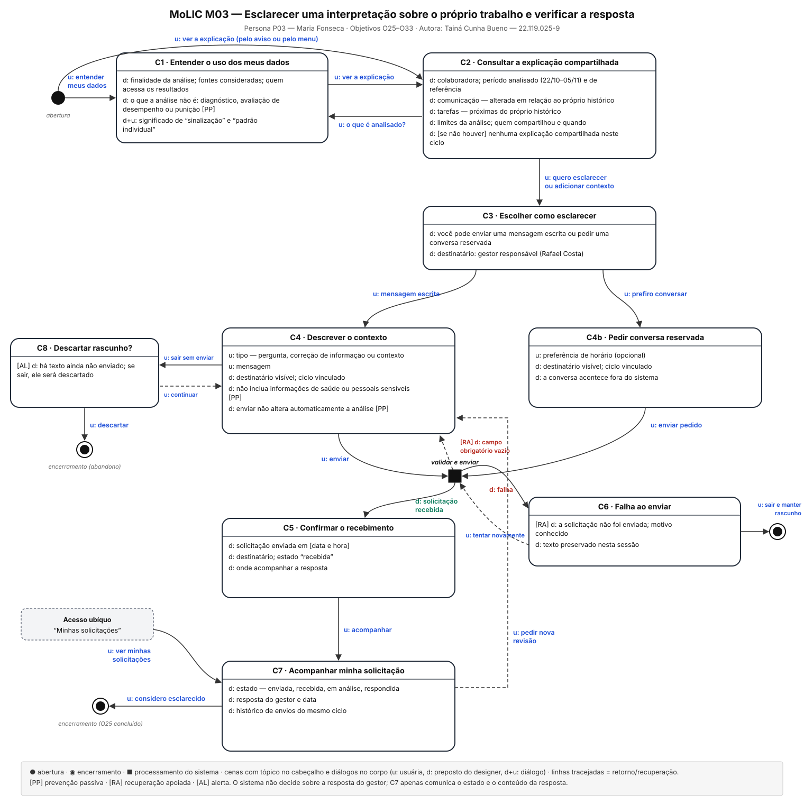

# Entrega 10 — MoLIC

**Data:** {{22/11/2026}}  
**Status:** 🟩 Concluida  
**Responsabilidade:** 1 solução completa por integrante

## Objetivo da atividade

Modelar a interação como uma **conversa entre usuário e preposto do designer**, oferecendo visão global dos caminhos que permitem ao usuário atingir seus objetivos — incluindo alternativas e rupturas relevantes. MoLIC não deve ser reduzida a um fluxograma de telas.

> Use a **notação MoLIC ensinada na disciplina**. Este template foca critérios de qualidade e não substitui a legenda/notação apresentada em aula.

## Atenção a TCCs sem interface original

O MoLIC não modela o algoritmo por dentro. Ele modela a **conversa de interação necessária para que uma pessoa use a contribuição**.

Exemplos de conversas:

- usuário escolhe dados/parâmetros → sistema valida → usuário inicia análise → sistema comunica processamento → usuário interpreta resultado;
- usuário consulta histórico → refina filtros → abre execução → compara com outra;
- administrador seleciona perfil → altera permissão → sistema comunica consequências → administrador confirma/cancela;
- analista recebe alerta → examina evidências → classifica ocorrência → registra decisão.

Modele também rupturas plausíveis: entrada inválida, falha de processamento, ausência de resultado, permissão insuficiente, filtro sem resultados, conflito de alteração, cancelamento ou necessidade de recuperação.

## M01 — Consultar uma análise e registrar o próximo passo humano

**Autor(a):** Caio Arnoni - 22.221.019-7   
**Cenário de interação de origem:** CI01, derivado de C01/E4-C01.     
**Objetivo(s):** O01 e seus desdobramentos O02–O10, conforme a Entrega 9.   
**Tarefa(s) relacionada(s):** T01 — Consultar uma análise e registrar o próximo passo humano.   
**Signos relevantes:** colaborador; período analisado; período de referência; padrão individual de referência; fontes; cobertura; última atualização; estado da análise; evidências de comunicação e de tarefas; sinalização; limites da análise; encaminhamento; justificativa; responsável pela retomada; data de retomada; estado do registro; motivo da falha.   

### Diagrama

**Fonte editável:** https://drive.google.com/file/d/1RCWIgjYGq3O19NqSB9n89yBGiDNeRZci/view?usp=sharing

### Leitura do diagrama

Explique em texto o caminho principal e pelo menos os caminhos alternativos/rupturas mais importantes.

cenas têm tópico no cabeçalho e diálogos/signos no corpo; `u:` identifica a fala do usuário, `d:` a do preposto e `d+u:` o diálogo. Quadrados pretos representam processamento do sistema; o círculo cheio indica abertura e o círculo duplo, encerramento. `gco` abre a conversa sobre o objetivo e `gcc` a fecha. Linhas tracejadas indicam retornos/recuperações. `PP` = prevenção passiva; `AL` = prevenção apoiada/alerta; `RA` = recuperação apoiada; `CE` = captura de erro sem recuperação dentro da própria interface.

#### Caminho principal

1. **Abertura → C1:** Rafael manifesta que deseja consultar uma análise. A conversa de O01 é aberta. Ele informa colaborador e período, entre casos autorizados e análises disponíveis.
2. **C1 → P1 → C2:** Rafael solicita a consulta; o sistema obtém a análise e apresenta identidade, períodos, fontes, cobertura, atualização, estado e limites. A obtenção da análise não é confundida com uma fala do usuário nem com uma conclusão sobre a pessoa.
3. **C2 → C3:** após conferir que há dados suficientes, Rafael solicita a interpretação das evidências. Comunicação e tarefas são apresentadas separadamente, comparadas ao histórico individual. O diálogo pode esclarecer termos e limites sem exigir uma cena distinta para cada explicação.
4. **C3 → C4:** Rafael define o próximo passo humano e informa justificativa, responsável e data quando aplicável. Uma mudança comunicacional não obriga uma decisão de intervenção; o sistema não faz diagnóstico.
5. **C4 → P2 → C5:** Rafael pede a revisão do encaminhamento. O sistema verifica as informações obrigatórias; estando válidas, apresenta o conteúdo ainda não salvo para conferência. Rafael pode retornar a C4 e revisar antes de confirmar.
6. **C5 → P3 → C6:** Rafael confirma o registro. O sistema tenta salvá-lo e somente em caso de sucesso informa a conclusão. C6 permite conferir colaborador, período, encaminhamento, justificativa, responsável e data registrada.
7. **C6 → encerramento:** Rafael declara que conferiu o registro e encerra. O01 está concluído; a conversa com Maria e a execução do acompanhamento não são declaradas realizadas pelo sistema.

#### Alternativas e rupturas

| Situação | Onde ocorre | Como o usuário percebe | Caminho de recuperação/saída |
|---|---|---|---|
| Caso/período sem análise disponível ou falha ao obter o resultado | P1 → C7 | `d: consulta indisponível`, com causa conhecida e sem apresentar dados fictícios como resultado válido | C7 → C1: Rafael revê a seleção ou tenta novamente. Se a solução depender de integração ou autorização externa, o sistema indica o responsável; Rafael pode encerrar sem concluir O01 |
| Análise incompleta | C2 → C8 | A cobertura informa a lacuna; C8 esclarece que não há base para concluir mudança ou estabilidade | Rafael pode voltar a C2 para rever os dados ou seguir a C4 para registrar insuficiência e um próximo passo, sem atribuir uma conclusão à pessoa |
| Dúvida sobre sinalização ou diferença entre comunicação e tarefas | Diálogo em C3 | Rafael pergunta pelo significado; o sistema apresenta referência, evidências e limites | O diálogo esclarece sem determinar a decisão; Rafael só segue a C4 quando decidir seu próximo passo |
| Interrupção breve na mesma sessão | Cena corrente, especialmente C2–C4 | Na retomada, permanecem identificados caso, período e conteúdo ainda não salvo | O09 é apoiado pela conservação do contexto; a interrupção não cria fala de transição nem salva automaticamente. Expiração de sessão está fora deste recorte |
| Dado obrigatório ausente ou inválido | P2 → C4 | `[RA] d: corrija o campo indicado`, preservando os demais dados | Corrigir em C4 e solicitar nova revisão. Exigir encaminhamento, justificativa e responsável; data é exigida ao acompanhar ou aguardar dados |
| Desejo de alterar o encaminhamento antes de salvar | C5 → C4 | Rafael comunica que quer revisar o conteúdo; não há confirmação de salvamento | Revisar, validar novamente em P2 e retornar a C5 |
| Falha ao salvar | P3 → C9 | `[RA] d: registro não salvo`, com motivo conhecido e conteúdo preservado durante a tentativa | Rafael pode tentar novamente em P3 ou rever os dados em C5 e, se necessário, C4; não considerar O01 concluído até C6 |
| Falha persistente sem recuperação local | C9 | Sistema informa a impossibilidade e orienta suporte, sem alegar sucesso | Rafael pode abandonar via C10, mantendo o registro como não concluído. Não se presume salvamento posterior automático |
| Abandono durante o preenchimento | C4 → C10 | `[AL] d: há conteúdo ainda não salvo`, comunicando a consequência de descartar | Continuar retorna a C4; confirmar abandono encerra O01 sem novo registro. Se veio de C9, continuar retoma o preenchimento preservado em C4 |
| Encerramento antes de iniciar o registro | C1–C3, C7 ou C8 | Rafael manifesta que deseja encerrar a consulta sem registrar | Encerrar como abandono de O01, não como conclusão bem-sucedida. Essas saídas são indicadas na nota do diagrama para evitar múltiplas linhas cruzadas |

## M02b — Acessar o sistema como gestor e cadastrar colaborador

**Autor(a):** Guilherme Matias — 22.122.071-8  
**Cenário de interação de origem:** CI02 (pré-condição de acesso) e T07 da Entrega 1 (cadastro de colaboradores).  
**Objetivo(s):** O22 (acessar o sistema como gestor), O23 (cadastrar e vincular colaborador) e O24 (recuperar acesso), a incluir na Entrega 9.  
**Signos relevantes:** e-mail do gestor; senha; "lembrar de mim" (estado da sessão); nome completo; e-mail corporativo; CPF; telefone; cargo; departamento; data de admissão; matrícula; Telegram ID; Trello ID; vínculo do colaborador (integrações com Telegram e Trello); estado da sessão.

### Diagrama

**Fonte editável:** https://drive.google.com/file/d/1ndkaVDJb_RzpL98fAZWBCgdGhcl0oxDM/view?usp=sharing

#### Caminho principal

1. **Abertura:** `u:` URL do WorkSense (`gco`: acessar o sistema como gestor). **Cena 1 "Identificar-se como gestor":** `d:` aviso de que o login é só para gestores e orientação para quem não tem acesso falar com o RH (`PP`); `d+u:` e-mail e senha; `u:` "lembrar de mim" (opcional).
2. **Processamento "validar credenciais".** Sendo válidas, `d:` acesso liberado leva à visão geral (cena 1 do M02), e a conversa de acesso se encerra (`gcc`).
3. **Cadastro:** pelo acesso ubíquo do menu lateral (`precond:` gestor autenticado; `gco`: cadastrar colaborador), João chega à **cena 3 "Cadastrar colaborador"**, organizada em duas partes: *Informações básicas* (nome completo, e-mail corporativo, CPF, telefone, cargo, departamento, data de admissão e matrícula) e *Integrações* (Telegram ID e Trello ID). A cena mostra exemplos de formato nos campos (`PP`) e o lembrete "confira os dados antes de concluir o cadastro".
4. **Processamento "validar dados"**, depois **processamento "salvar cadastro"**, depois **cena 4 "Colaborador cadastrado"**, que mostra o cadastro salvo com os vínculos de Telegram ID e Trello ID. Dali João cadastra outro (retorno à cena 3) ou conclui (`gcc`).

#### Alternativas e rupturas

| Situação | Onde ocorre | Como o usuário percebe | Caminho de recuperação/saída |
|---|---|---|---|
| E-mail ou senha incorretos | Validar credenciais | `d:` e-mail ou senha incorretos (`RA`) | Retorno tracejado à cena 1 |
| Usuário sem perfil de gestor | Validar credenciais | `d:` acesso permitido apenas a gestores (`RA`) | Retorno tracejado à cena 1 |
| Quem não tem acesso | Cena 1 | `d:` orientação "fale com o RH" (`PP`); a solicitação ocorre fora do sistema | Contato com o RH fora do sistema |
| Esqueceu a senha | Cena 1 | `u:` esqueci a senha | Cena 2 "Recuperar acesso"; e-mail inválido volta a ela (`RA`); `u:` voltar ao login |
| Campo vazio ou formato inválido | Validar dados | `d:` indica o campo e mantém os demais (`RA`) | Retorno tracejado à cena 3 |
| CPF, matrícula, Telegram ID ou Trello ID já cadastrado ou vinculado | Validar dados | `d:` informa o dado em conflito (`RA`) | Corrigir o dado na cena 3 |
| Vínculo digitado errado | Cena 3 e cena 4 | Prevenção na cena 3 (`PP`: exemplos de formato e lembrete de conferência); a cena 4 mostra os vínculos salvos | Correção posterior do cadastro fica fora do escopo do M02b |
| Erro ao salvar | Salvar cadastro | `d:` erro ao salvar; dados mantidos (`RA`) | Retorno tracejado à cena 3 |
| Cancelar ou sair com dados não gravados | Cena 3 (`u:` cancelar) e acesso ubíquo "sair" | Cena 5: `d:` há alterações não gravadas (`AL`) | `u:` sair sem salvar (`gcc`) ou `u:` continuar editando (retorno à cena 3) |

## M03 — Esclarecer uma interpretação sobre o próprio trabalho e verificar a resposta

**Autor(a):** Tainá Cunha Bueno — 22.119.025-9  
**Cenário de interação de origem:** CI03, derivado de C03/E4-C03.  
**Objetivo(s):** O25 e seus desdobramentos O26–O33, conforme a Entrega 9.  
**Tarefa(s) relacionada(s):** T03 — Esclarecer uma interpretação sobre o próprio trabalho e verificar a resposta.  
**Signos relevantes:** finalidade da análise; fontes; acesso aos resultados; explicação compartilhada; período analisado; período de referência; evidências de comunicação e de tarefas; limites da análise; forma de contato; tipo de solicitação; mensagem de contexto; destinatário; estado da solicitação; resposta; motivo da falha.  

### Diagrama

**Fonte editável:** [`molic_m03.svg`](../assets/10_molic/molic_m03.svg)

### Leitura do diagrama

As cenas têm o tópico no cabeçalho e diálogos e signos no corpo; `u:` identifica a fala da usuária, `d:` a do preposto e `d+u:` o diálogo. O quadrado preto representa processamento do sistema; o círculo cheio indica abertura e o círculo duplo, encerramento. Linhas tracejadas indicam retornos e recuperações. `PP` = prevenção passiva; `AL` = alerta; `RA` = recuperação apoiada.

#### Caminho principal

1. **Abertura → C2:** Maria manifesta que quer ver a explicação, a partir do aviso de compartilhamento ou do menu. Se for a primeira vez, pode passar antes por **C1 — Entender o uso dos meus dados**, onde o sistema comunica finalidade, fontes, quem acessa e o que a análise não é (O26).
2. **C2 — Consultar a explicação compartilhada:** o sistema apresenta o período analisado e o de referência, quem compartilhou e quando, as dimensões de comunicação e tarefas separadas e os limites da análise (O27). Maria pode voltar a C1 para perguntar o que é analisado.
3. **C2 → C3 — Escolher como esclarecer:** Maria diz que quer esclarecer ou adicionar contexto; o sistema apresenta as duas formas e o destinatário (O28).
4. **C3 → C4 — Descrever o contexto:** ela escolhe a mensagem escrita, informa o tipo e escreve. O sistema mostra o destinatário e o ciclo vinculado e previne, de forma passiva, a inclusão de dados sensíveis e a expectativa de que o envio altere a análise.
5. **C4 → validar e enviar → C5 — Confirmar o recebimento:** o sistema valida e envia; somente em caso de sucesso comunica que a solicitação foi recebida, com data, destinatário e estado (O29, O30). O recebimento pelo sistema não significa que o gestor já leu a mensagem.
6. **C5 → C7 — Acompanhar minha solicitação:** Maria acompanha o estado (enviada, recebida, em análise, respondida) e lê a resposta (O31). C7 também é alcançada pelo acesso ubíquo “Minhas solicitações”.
7. **C7 → encerramento:** Maria declara que considera o assunto esclarecido. O25 está concluído; a decisão de encerrar é dela, não do sistema.

#### Alternativas e rupturas

| Situação | Onde ocorre | Como a usuária percebe | Caminho de recuperação/saída |
|---|---|---|---|
| Nenhuma explicação compartilhada no ciclo | C2 | `d: nenhuma explicação compartilhada neste ciclo` | Maria pode seguir a C3 e enviar uma pergunta geral ao gestor |
| Prefere não escrever | C3 → C4b | Opção “prefiro conversar” ao lado da mensagem escrita | Em C4b informa, se quiser, uma preferência de horário; o pedido segue o mesmo processamento e confirmação. A conversa acontece fora do sistema |
| Campo obrigatório vazio | validar e enviar → C4 | `[RA] d: escreva sua mensagem antes de enviar`, com o restante preservado | Corrigir em C4 e enviar novamente |
| Falha ao enviar | validar e enviar → C6 | `[RA] d: a solicitação não foi enviada`, com motivo conhecido e texto preservado | Tentar novamente volta ao processamento; Maria também pode sair mantendo o rascunho na sessão atual, sem que o sistema alegue envio (O33) |
| Sair antes de enviar | C4 → C8 | `[AL] d: há texto ainda não enviado; se sair, ele será descartado` | Continuar volta a C4; descartar encerra O25 como abandono |
| Resposta não considera o contexto | C7 → C4 | Maria lê a resposta e indica que não foi considerada | “Pedir nova revisão” reabre C4 vinculada à mesma solicitação (O32) |
| Espera pela resposta | C7 | Estado “recebida” ou “em análise” | Maria pode voltar depois pelo acesso ubíquo; o sistema não promete prazo que não controla |

**Fora do modelo:** a conversa pessoal entre Maria e Rafael, a eventual revisão da análise pela equipe, a persistência de rascunhos entre sessões e notificações por outros canais.
  
### Checklist específico de modelagem

- [ ] Existe **ponto de abertura** coerente com o início do objetivo.
- [ ] As **cenas de conversa** representam tópicos/assuntos, não nomes de páginas apenas.
- [ ] As transições/falas deixam claro o que o usuário ou o sistema comunica.
- [ ] Há **ponto(s) de encerramento** para objetivos concluídos/abandonados quando aplicável.
- [ ] Processamentos do sistema estão representados conforme a notação adotada em aula, sem “inventar” fala do usuário.
- [ ] Rupturas (breakdowns) relevantes têm feedback e caminho de recuperação, não becos sem saída.
- [ ] Acessos ubíquos/atalhos só aparecem quando semanticamente justificáveis.
- [ ] O diagrama cobre caminhos alternativos importantes, e não apenas o “happy path”.
- [ ] Nomes de objetivos, tópicos e signos são coerentes com a Entrega 9.
- [ ] O diagrama é legível em tamanho normal no GitHub.
- [ ] O MoLIC representa a conversa usuário–sistema, não o fluxo interno do algoritmo.
- [ ] Processamento, filtros, administração, relatórios e históricos incluem retornos/rupturas quando relevantes.

> Repita M02, M03... para todos os integrantes.

## Consolidação da equipe

### Cobertura dos objetivos

| Objetivo | MoLIC que cobre | Lacunas/duplicidades | Decisão |
|---|---|---|---|
| O01 — Consultar uma análise e registrar o próximo passo humano | M01, entrada até conclusão/abandono | Cobertura do recorte T01; outros modelos ainda não integrados | Manter como objetivo central de Rafael |
| O02 — Localizar a análise pertinente | M01, C1/P1/C7 | Sem comparação com os modelos dos colegas | Reutilizar o conceito colaborador + período |
| O03 / O06 — Avaliar limites e conferir contexto | M01, C2/C3/C8 | Pode ser compartilhado com outros gestores | Consolidar vocabulário após comparar os modelos |
| O07 — Interpretar comunicação e tarefas separadamente | M01, C3 | Não equivale a comparar colaboradores | Preservar a separação das dimensões |
| O08 — Reconhecer insuficiência | M01, C8 e encaminhamento em C4 | Não deve ser confundido com estabilidade | Manter caminho próprio de interpretação da limitação |
| O04 / O05 — Definir e registrar encaminhamento | M01, C4/P2/C5/P3/C6 | Acompanhamento após a conversa humana está fora de T01 | Não declarar intervenção ou conversa já executada |
| O09 — Retomar após interrupção | M01, conservação da cena e signos durante a sessão | Não inclui expiração de sessão ou retomada em outro dispositivo | Manter o limite explícito e avaliar necessidade futura |
| O10 — Recuperar falha de registro | M01, C9 e retornos a P3/C5 | Persistência real não testada no protótipo | Simular feedback, correção e nova tentativa |
| O11 Fazer a triagem da equipe e registrar o encaminhamento | M02: abertura (`gco`) até os três `gcc` | Duplica o O01 (mesma meta; muda a persona e a tarefa) | Unificar com o O01 no mapa consolidado, mantendo M01 e M02 como variantes: o M02 tem o caminho curto |
| O12 Obter a leitura inicial da equipe em linguagem simples | M02: Cena 1 | Parcial com o O02; o M02 parte do resumo da equipe, e o M01 parte da escolha de colaborador e período | Manter, como alternativa de entrada do O02 |
| O13 Decidir se vale aprofundar | M02: Cena 2 (caminho curto e completo) | Sem equivalente no M01, porque o Rafael sempre aprofunda | Manter; é exclusivo do P02 |
| O14 Verificar a confiabilidade da análise | M02: processamento de estado e Cena 3 | Equivale ao O06, e o O14 acrescenta o estado da análise | Unificar em um nome só (O06) |
| O15 Entender o que mudou em cada dimensão | M02: Cenas 3 e 4 | Equivale ao O07 | Unificar no O07 |
| O16 Consultar o significado dos termos e do sinal | M02: Cenas 2 e 5 | Parcial com o O03; a ajuda de termos (lacuna ?03) só existe no M02 | Manter e sugerir ao Caio incluir ajuda de termos |
| O17 Reconhecer análise não confiável e aguardar dados | M02: Cena 3b | Equivale ao O08; no M02 só se permite "aguardar dados" | Unificar no O08 |
| O18 Considerar o contexto humano antes de agir | M02: Cena 6 | Relacionado ao O04; a cena só tem fala `d:`, pois a conversa ocorre fora do sistema | Manter ligado ao O04 ou fundir com ele |
| O19 Registrar e conferir o encaminhamento | M02: Cenas 7, 8 e 9 | Equivale ao O05; o M02 não tem "responsável pela retomada" | Unificar no O05 e decidir se o campo "responsável" entra no M02 |
| O20 Retomar a consulta após interrupção | M02: acesso ubíquo "retomar consulta" | Equivale ao O09, sem lacuna aparente | Unificar no O09 |
| O21 Recuperar uma falha de registro | M02: Cena 10 | Equivale ao O10; o M02 acrescenta "deixar pendente" (`CE`) | Unificar no O10 |
| O22 Acessar o sistema como gestor | M02b: cena 1 e validar credenciais | O M03 parte de uma sessão já autenticada. O acesso específico da colaboradora não foi modelado, e o M02b cobre apenas o acesso do gestor | Verificar a inclusão de O22 na Entrega 9 e definir a política de acesso da colaboradora |
| O23 Cadastrar e vincular colaborador | M02b: cenas 3, 4 e 5 (cadastro, validação, conclusão e saída sem salvar) | Ainda não está na Entrega 9; os signos do cadastro (CPF, cargo, departamento, data de admissão, matrícula, Telegram ID, Trello ID) seguem o protótipo do Figma | Incluir na Entrega 9 |
| O24 Recuperar acesso | M02b: cena 2 "Recuperar acesso" | Ainda não está na Entrega 9 | Incluir na Entrega 9, ou cortar a cena se o professor achar fora de escopo |
| O25 — Esclarecer uma interpretação sobre o próprio trabalho e verificar a resposta | M03, abertura até conclusão ou abandono | Sem duplicidade; é o objetivo central da colaboradora | Manter como objetivo central de P03 |
| O26 — Compreender finalidade, fontes, acesso e limites | M03, C1 | Relacionado a O03, mas com leitora e permissões diferentes | Manter separado; reaproveitar vocabulário de limites |
| O27 — Compreender a explicação compartilhada | M03, C2 | Relacionado a O07/O15 (dimensões separadas) | Reaproveitar os mesmos signos de comunicação e tarefas |
| O28 — Escolher como apresentar o contexto | M03, C3 | Sem equivalente nos outros modelos | Manter |
| O29 — Enviar contexto ou pedido ao destinatário correto | M03, C4/C4b e processamento | Sem equivalente | Manter |
| O30 — Confirmar o recebimento | M03, C5 | Análogo a O05/O19 (conferir resultado registrado) | Manter a mesma regra: só confirmar após sucesso |
| O31 — Acompanhar a solicitação e ler a resposta | M03, C7 e acesso ubíquo | Sem equivalente | Manter |
| O32 — Pedir nova revisão | M03, C7 → C4 | Sem equivalente | Manter vinculada à solicitação anterior |
| O33 — Recuperar falha de envio | M03, C6 | Equivale a O10/O21 | Unificar no mapa consolidado com O10 |

### Preparação para o Figma

Liste os estados/telas que serão necessários **a partir das conversas modeladas**, incluindo feedback, confirmação, erro e recuperação.

## Erros frequentes a evitar

- desenhar apenas caixas com nomes de telas e setas de navegação;
- não modelar falhas, cancelamento, volta ou recuperação;
- usar rótulos genéricos (“Tela 1”, “Processo 2”) sem tópico de conversa;
- criar no Figma fluxos que não existem no MoLIC;
- diagrama sem legenda/fonte editável e com texto ilegível.

**Telas e estados necessários para M03 — Tainá:**

| Cena MoLIC | Tela ou estado previsto | Finalidade |
|---|---|---|
| C1 | F14 — Sobre minhas análises | Informar finalidade, fontes, acesso e limites da análise |
| C2 | F15 — Explicação do ciclo | Apresentar as dimensões de comunicação e tarefas e os períodos comparados |
| C2 | F15 — Estado sem explicação compartilhada | Informar a ausência de explicação e permitir uma pergunta geral |
| C3 / C4 | F16 — Esclarecer ou adicionar contexto | Escolher a forma de contato, escrever a mensagem e conferir o destinatário |
| C4b | F16 — Conversa reservada | Solicitar uma conversa com o gestor |
| C4 | F16-E1 — Campo obrigatório vazio | Informar o erro de preenchimento e permitir a correção |
| C6 | F16-E2 — Falha ao enviar | Informar a falha, preservar o texto e permitir nova tentativa |
| C8 | F16 — Confirmação de descarte | Evitar a perda acidental de texto |
| C5 | F17 — Solicitação recebida | Confirmar o recebimento e orientar sobre o acompanhamento |
| C7 | F18 — Minhas solicitações | Apresentar estados, resposta do gestor e opções de encerramento ou nova revisão |
