# Entrega 13 — Avaliação de IHC por inspeção heurística

**Data:** 25/11/2026  
**Status:** 🟩 Concluída  
**Responsabilidade:** 1 avaliação completa por integrante, sobre todas as telas/estados relevantes do projeto.

## Objetivo da atividade

Encontrar problemas de usabilidade por inspeção sistemática da interface com as **10 heurísticas de Nielsen**. Cada avaliador trabalha individualmente primeiro; depois a equipe consolida problemas duplicados e prioridades.

> **Parte de violações:** registre somente problemas reais. Não invente uma violação para “preencher” cada heurística. Para provar que todas foram exercitadas, use a **matriz de cobertura H1–H10**. Para heurísticas sem violação, a disciplina solicita um exemplo didático de boa prática.

## 1. Heurísticas adotadas

1. Visibilidade do status do sistema
2. Compatibilidade entre o sistema e o mundo real
3. Controle e liberdade do usuário
4. Consistência e padrões
5. Prevenção de erros
6. Reconhecimento em vez de memorização
7. Flexibilidade e eficiência de uso
8. Estética e design minimalista
9. Ajudar usuários a reconhecer, diagnosticar e recuperar-se de erros
10. Ajuda e documentação

## Cobertura especial para interfaces administrativas e analíticas

Quando existirem, não limite a avaliação às “telas principais”. Inspecione também:

- dashboard em estados normal, vazio e erro;
- filtros sem resultado e filtros combinados;
- relatórios e exportação;
- histórico/listas longas;
- formulários CRUD (criação, edição, exclusão, validação);
- alteração de perfil/permissão;
- confirmações de ações destrutivas;
- processamento/loading/progresso;
- falha e recuperação;
- comparação de resultados;
- mensagens de termos técnicos, métricas e recomendações;
- ajuda/documentação contextual.

Em TCCs técnicos, observe especialmente se a interface comunica o estado do processamento e traduz informações técnicas para o vocabulário do usuário escolhido.

## 2. Escopo da inspeção

| Item | Definição |
|---|---|
| Versão avaliada | Capturas documentadas na Entrega 11 em 25/11/2026. Referência: https://www.figma.com/design/McbDfvqqGuDnR9uDmBdJrp/Login-e-Cadastro-de-Colaboradores?node-id=0-1&p=f&t=P0yKLlrbv12dHvD4-0. |
| Telas/estados | F06: visão geral; F07: sinalização; F08: confiabilidade completa; F09: análise incompleta; F10: registro; F11: confirmação; F12: registro com insuficiência; F13: confirmação de aguardar dados. IDs documentais, não IDs internos do Figma. |
| Fluxos | M01/T01: consulta, interpretação, encaminhamento e confirmação, com variante de insuficiência. Recuperação de falha, abandono e fluxos dos demais integrantes precisam ser examinados para cumprir o escopo integral. |
| Dispositivo/viewport | Revisão de imagens estáticas de interface desktop; navegador, zoom e viewport de execução não aferidos nesta revisão. |
| Avaliadores |A01: Caio Arnoni 22.221.019-7 |

## 3. Procedimento individual

Cada avaliador deve:

1. percorrer os fluxos/telas ao menos uma vez para familiarização;
2. inspecionar novamente aplicando sistematicamente H1–H10;
3. registrar cada problema com evidência e contexto;
4. atribuir severidade **depois de compreender bem o problema**, justificando a decisão;
5. não discutir achados com os demais antes de terminar a inspeção individual, quando o objetivo for preservar independência.

### Escala de severidade (0–4)

| Grau | Interpretação |
|---:|---|
| 0 | Não é considerado problema de usabilidade. |
| 1 | Problema cosmético; corrigir se houver tempo. |
| 2 | Problema menor; baixa prioridade. |
| 3 | Problema maior; alta prioridade. |
| 4 | Catástrofe de usabilidade; correção imperativa antes de disponibilizar. |

Ao justificar, considere **frequência, impacto e persistência** do problema no contexto real de uso.

---

## Avaliador A01 — Caio Arnoni

### 4. Matriz de cobertura das 10 heurísticas

| Heurística | Telas/fluxos examinados | Houve violação? | IDs dos achados | Exemplo de boa prática se não violada |
|---|---|---|---|---|
| H1 | F06, F08, F09, F11 e F13: status e confirmação representados. | Não | — | F09 informa falta de dados; F11/F13 apresentam resumo da confirmação. |
| H2 | F06: resumo da equipe e significado da ação de registro. | Sim | V03 | Não se aplica como declaração de ausência de violação. |
| H3 | F07–F10/F12: controles de retorno e continuidade representados. | Sim | — | “Voltar à sinalização” e “Voltar à visão geral” indicam alternativas de navegação |
| H4 | F10/F11: opção e confirmação; F12: seleção exclusiva. | Não | V01, V02 | Não se aplica como declaração de ausência de violação. |
| H5 | F12: restrição anunciada e opções apresentadas. | Não | V01 | Não se aplica como declaração de ausência de violação. |
| H6 | F06–F13: pessoa, ciclo, navegação contextual e resumo. | Sim | — | Identificação de M. F. e ciclo visíveis reduzem a necessidade de lembrar qual caso está em consulta. |
| H7 | F06: retomada de rascunho e acesso à sinalização. | Não | — | A ação “Retomar” representa um acesso direto à atividade interrompida; funcionamento e eficiência não medidos. |
| H8 | F07/F08: organização das informações em grupos. | Não | — | Comunicação, atividades e cobertura possuem títulos próprios, favorecendo a leitura por assunto. Legibilidade em outros tamanhos não verificada. |
| H9 | F09/F12: estado de insuficiência. | Sim | — | A mensagem informa ausência de dados do Telegram e sugere verificar o identificador; não comprova recuperação de falha de salvamento. |
| H10 | F07–F09: significado, limites e comparação. | Não | — | “O que este sinal NÃO significa” explica limites e evita tratar a sinalização como diagnóstico ou avaliação de desempenho. |

### 5. Declaração de violações

| ID | Heurística | Tela/estado | Problema observado | Evidência | Severidade | Justificativa da severidade | Recomendação |
|---|---|---|---|---|---:|---|---|
| V01 | H4, H5 | F12 — Registro com análise incompleta | Ao visualizar os encaminhamentos, o gestor encontra “Apoiar” e “Aguardar dados” selecionados simultaneamente, embora só aguardar dados seja permitido pelo aviso. Isso torna ambígua a decisão a registrar. |  | 3 — Maior, preliminar | Frequência potencial: toda abertura desse estado na versão representada. Impacto: dúvida sobre a decisão válida. Persistência: a contradição permanece enquanto os controles não forem corrigidos. Não foi verificado o valor salvo. | Desmarcar e desabilitar as opções incompatíveis com insuficiência; manter somente “Aguardar dados” selecionado e conferir sua preservação na confirmação. |
| V02 | H4 | F10/F11 — Registro e confirmação | O formulário mostra “Apoiar”, enquanto a confirmação mostra “Acompanhar”, sem mudança intermediária documentada. Se forem etapas do mesmo fluxo, o resultado diverge da escolha. |  | 3 — Maior, se confirmado no mesmo fluxo | Frequência e persistência dependem do encadeamento, ainda não verificado. Impacto potencial alto: perda de confiança e confirmação de decisão diferente. A divergência visual é real, mas não comprova alteração durante a navegação. | Conferir o encadeamento e alinhar escolha e confirmação. Se forem cenários independentes, identificá-los. Testar cada opção até seu resumo final. |
| V03 | H2 | F06 — Visão geral | O rótulo “Está tudo certo, registrar e sair” induz uma conclusão geral positiva diante de sinalização e insuficiência, sem explicitar a pessoa destinatária do registro. |  | 2 — Menor, preliminar | Frequência potencial: acesso à visão geral nesse estado. Impacto: ambiguidade e possível encerramento prematuro; existe alternativa visível para consultar o sinal. Persistência: o rótulo reaparece a cada acesso enquanto mantido. Destino do botão ainda não verificado. | Adotar rótulo neutro, como “Registrar encaminhamento”, e explicitar o caso ao qual se aplica; não afirmar que está tudo certo diante de dados insuficientes. |

**Qualidade do relato:** o problema deve ser observável e localizado. Evite “interface confusa” sem dizer **o que**, **onde**, **quando** e **para quem**.

### 6. Boas práticas — heurísticas não violadas (atividade didática)

| Heurística sem violação | Exemplo no sistema | Evidência | Por que atende |
|---|---|---|---|
| H1 — aspecto local | Informação de insuficiência. |  | Torna explícito o estado e sua limitação, em vez de apresentar ausência de dados como estabilidade. |
| H3 — intenção representada | Alternativas de retorno. |   | Indica uma saída sem obrigar o registro. O funcionamento precisa ser verificado. |
| H6 — aspecto local | Contexto visível. |  | Permite reconhecer o contexto sem depender exclusivamente da memória da tela anterior. |
| H7 — intenção representada | Retomada de rascunho. |  | Pode reduzir etapas de reencontro da atividade; a retomada real ainda deve ser testada. |
| H8 — aspecto local | Agrupamento por assunto. |  | Ajuda a localizar informações relacionadas sem misturar dimensões diferentes. |
| H9 — aspecto local | Explicação da falta de dados. |  | Expõe uma causa a verificar e uma ação possível, sem depender apenas de código de erro. |
| H10 — aspecto local | Ajuda contextual. | | Oferece explicação junto à informação que o gestor precisa interpretar. |

> Repita a seção para A02, A03... um avaliador por integrante.

### 2. Escopo da inspeção (linhas do avaliador A02)

| Item | Definição |
|---|---|
| Versão avaliada | PDF do protótipo no Figma "Login e Cadastro de Colaboradores" (2 telas), 25/11/2026. Referência: https://www.figma.com/design/McbDfvqqGuDnR9uDmBdJrp/Login-e-Cadastro-de-Colaboradores |
| Telas/estados | L01: login do gestor, estado padrão; L02: cadastrar colaborador, estado padrão. IDs documentais, não IDs internos do Figma. |
| Fluxos | M02b: acessar o sistema como gestor e cadastrar colaborador. Não aparecem no PDF: erro de login, recuperar acesso, erro de validação, confirmação do vínculo, colaborador cadastrado e confirmar saída. Esses estados não foram avaliados. |
| Dispositivo/viewport | Imagens estáticas de interface desktop; navegador, zoom e viewport não aferidos. |
| Avaliadores | A02: Guilherme Matias 22.122.071-8 |

## 3. Procedimento individual

Cada avaliador deve:

1. percorrer os fluxos/telas ao menos uma vez para familiarização;
2. inspecionar novamente aplicando sistematicamente H1–H10;
3. registrar cada problema com evidência e contexto;
4. atribuir severidade **depois de compreender bem o problema**, justificando a decisão;
5. não discutir achados com os demais antes de terminar a inspeção individual, quando o objetivo for preservar independência.

### 4. Matriz de cobertura das 10 heurísticas

| Heurística | Telas/fluxos examinados | Houve violação? | IDs dos achados | Exemplo de boa prática se não violada |
|---|---|---|---|---|
| H1 | L02: menu lateral e trilha de navegação | Não | — | O item "Colaboradores" fica destacado no menu e a trilha "Colaboradores / Novo cadastro" mostra onde o gestor está. Estados de carregamento e sucesso não existem no PDF. |
| H2 | L01: painel de apresentação | Sim | V04 | Não se aplica |
| H3 | L02: saídas do formulário | Não | — | O botão "Cancelar" e a trilha de navegação dão saída sem registrar. O aviso de dados não gravados não foi avaliado. |
| H4 | L01 e L02: identidade visual e campos | Sim | V11, V12 | Não se aplica |
| H5 | L01 (senha, "lembrar de mim") e L02 (campos, obrigatoriedade) | Sim | V05, V06, V08, V09, V10 | Não se aplica |
| H6 | L01 e L02: rótulos e menu | Não | — | Rótulos fixos acima dos campos e menu com item ativo reduzem a memorização. |
| H7 | L02: formulário e ações | Não | — | Todos os campos e as duas ações cabem em uma tela, sem rolagem na captura. Teclas e atalhos não foram verificados. |
| H8 | L01 e L02: painel, cartão e selos | Sim | V04, V08, V13 | Não se aplica |
| H9 | Nenhuma tela de erro no PDF | Não examinada | — | Estados de erro não representados; não há exemplo a citar |
| H10 | L01 ("Fale com o RH") e L02 (IDs) | Sim | V07, V10 | Não se aplica |

### 5. Declaração de violações

| ID | Heurística | Tela/estado | Problema observado | Evidência | Severidade | Justificativa da severidade | Recomendação |
|---|---|---|---|---|---:|---|---|
| V04 | H2, H8 | L01 — Login | O painel verde ocupa quase metade da tela com frases promocionais e uma lista "Colaboradores / Jornadas e rotinas / Solicitações". "Jornadas e rotinas" e "Solicitações" não correspondem a nenhum item do menu da L02 nem às conversas do M02 e do M02b. |  | 2 — Menor, preliminar | Frequência: todo acesso. Impacto: cria a expectativa de funções que o sistema não tem e disputa atenção com o formulário. Persistência: constante. Pode ser decisão de produto, a validar. | Reduzir o painel a nome, frase curta e propósito. Listar só o que o sistema oferece. |
| V05 | H5 | L01 — Login | "Lembrar de mim" aparece sem explicar o que mantém nem por quanto tempo, em um sistema com dados de colaboradores usado em sala compartilhada (P02 e CT01). |  | 2 — Menor, preliminar | Frequência: todo acesso. Impacto: quem marca em computador compartilhado deixa o acesso aberto a outra pessoa. Persistência: constante. O comportamento não foi verificado e depende da implementação. | Explicar o efeito ("manter conectado neste dispositivo por X dias") e avisar para não usar em computador compartilhado, ou remover a opção. |
| V06 | H5 | L01 — Login | O campo de senha não tem controle para mostrar ou ocultar o que foi digitado. |  | 1 — Cosmético, preliminar | Frequência: todo login. Impacto: baixo; o erro de digitação só aparece depois de falhar. Persistência: constante. Não foi verificado se o controle existe fora da captura. | Incluir o controle de mostrar ou ocultar a senha. |
| V07 | H10, H6 | L01 — Login | "Não tem acesso? Fale com o RH" é texto cinza sem aparência de link e sem canal indicado (e-mail ou formulário). |  | 2 — Menor | Frequência: quando o gestor ainda não tem acesso. Impacto: ele fica sem caminho concreto para resolver. Persistência: constante. | Transformar em link para um canal de contato ou indicar o e-mail ou o responsável. |
| V08 | H8, H5 | L02 — Cadastro | O formulário pede CPF, cargo, departamento, data de admissão e matrícula, que não aparecem nos fluxos modelados (o M02b usa nome, e-mail, telefone, Telegram ID e Trello ID). Metade dos campos fica fora da tarefa, e o CPF é um identificador pessoal. |  | 3 — Maior, preliminar | Frequência: todo cadastro. Impacto: mais esforço, risco de privacidade e contradição com o princípio de necessidade registrado na Entrega 1 (F03). Persistência: constante. A equipe pode ter decidido por esses campos; validar antes de corrigir. | Manter só os campos necessários ao vínculo. Se algum for necessário, justificar e marcar como opcional. |
| V09 | H5 | L02 — Cadastro | Nenhum campo indica se é obrigatório ou opcional. O único aviso é "Confira os dados antes de concluir o cadastro" no rodapé. |  | 2 — Menor, preliminar | Frequência: todo cadastro. Impacto: o gestor só descobre quais campos faltam ao tentar concluir. Persistência: constante. As mensagens de validação não foram avaliadas. | Marcar os obrigatórios (ou os opcionais) de forma consistente. |
| V10 | H10, H5 | L02 — Cadastro | Telegram ID e Trello ID têm exemplo de formato no campo, mas nada diz onde encontrar o ID. O Trello ID é uma sequência longa de letras e números, difícil de obter para quem tem pouca familiaridade técnica (P02). |  | 3 — Maior, preliminar | Frequência: todo cadastro. Impacto: um ID errado vincula o colaborador à fonte errada, e a análise passa a usar dados de outra pessoa. Persistência: constante. A confirmação do vínculo prevista no M02b não aparece no PDF. | Incluir "Onde encontro?" com passo a passo curto, validar o formato e mostrar uma confirmação do vínculo antes de salvar. |
| V11 | H4, H6 | L02 — Cadastro | "Cargo", "Departamento" e "Data de admissão" têm a mesma aparência dos campos de texto, sem seta nem ícone de calendário. |  | 2 — Menor, preliminar | Frequência: todo cadastro. Impacto: o gestor pode tentar digitar onde deveria selecionar. Persistência: constante. O comportamento real não foi verificado. | Mostrar seta nas listas e ícone de calendário na data. |
| V12 | H4 | L01 e L02 | As duas telas usam identidades diferentes: logotipo "WorkSense" no login e "worksense" no menu; painel verde-escuro versus menu cinza-escuro; botão primário verde-escuro com texto branco versus verde-claro com texto escuro. |  | 1 — Cosmético | Frequência: toda passagem do login para o cadastro. Impacto: parece haver dois produtos. Persistência: constante. | Padronizar logotipo, cor e estilo do botão primário. |
| V13 | H8 | L02 — Cadastro | Há elementos decorativos sem função: o cartão "MAIS CONEXÃO" no menu, o selo "Novo colaborador" que repete o título e a trilha, e o ponto verde junto de "Área do gestor", que lembra um indicador de "online". |  | 1 — Cosmético, preliminar | Frequência: todo acesso. Impacto: baixo, mas o ponto verde pode ser lido como status. Persistência: constante. | Remover o cartão e o selo, ou dar função clara ao ponto verde. |

### 6. Boas práticas — heurísticas não violadas (atividade didática)

| Heurística sem violação | Exemplo no sistema | Evidência | Por que atende |
|---|---|---|---|
| H1 | Item "Colaboradores" ativo e trilha "Colaboradores / Novo cadastro" | Figura A | O gestor sabe onde está sem depender da memória. |
| H3 | "Cancelar" e trilha de navegação | Figura A | Oferecem saída sem concluir. O aviso de dados não gravados não foi avaliado. |
| H6 | Rótulos fixos e menu com item ativo | Figura A | O rótulo continua visível durante o preenchimento. |
| H7 | Formulário completo e ações em uma só tela | Figura A | Reduz o esforço de rolagem. Teclas e atalhos não foram verificados. |
| H10 — aspecto local | Exemplos de formato nos campos Telegram e Trello | Mesma imagem do V10 (seção 5) | Mostram como o dado deve ser digitado. Falta indicar onde encontrá-lo (V10). |
| H4 — aspecto local | "Esqueci a senha" como link verde ao lado de "Lembrar de mim" | Mesma imagem do V05 (seção 5) | Tem aparência de link e está perto do campo de senha. |

**Figura A** — Tela L02 (cadastro de colaborador) completa.

## Avaliador A03 — Tainá Cunha Bueno

### 2. Escopo da inspeção (linhas do avaliador A03)

| Item | Definição |
|---|---|
| Versão avaliada | Protótipo no Figma “Login e Cadastro de Colaboradores”, imagens exportadas em 27/11/2026. Referência: https://www.figma.com/design/McbDfvqqGuDnR9uDmBdJrp/Login-e-Cadastro-de-Colaboradores |
| Telas/estados | Login e cadastro (L01/L02); fluxo do gestor F06–F13; fluxo da colaboradora F14–F18, incluindo F15-vazio, F16-conversa, F16-E1, F16-E2, F16-sair, F18-aguardando e F18-esclarecida. |
| Fluxos | M02b (acesso e cadastro), M01/T01 (consulta e registro de encaminhamento) e M03/T03 (esclarecimento e acompanhamento da solicitação). |
| Dispositivo/viewport | Protótipo desktop, com imagens de 1280 pixels de largura e alturas variáveis. Inspeção visual das telas exportadas, sem aferição das interações. |
| Avaliadores | A03: Tainá Cunha Bueno — 22.119.025-9. As telas F14–F18 foram desenvolvidas pela própria avaliadora. |

### 4. Matriz de cobertura das 10 heurísticas

| Heurística | Telas/fluxos examinados | Houve violação? | IDs dos achados | Exemplo de boa prática se não violada |
|---|---|---|---|---|
| H1 — Visibilidade do estado do sistema | F06, F10, F12, F15-vazio, F17 e F18 | Sim | V18, V21 | — |
| H2 — Correspondência com o mundo real | L01/L02, F06–F08, F14, F15 e F17 | Sim | V16, V21, V25, V26 | — |
| H3 — Controle e liberdade do usuário | F07–F10, F12, F16-sair e F18 | Não identificada | — | F16-sair permite continuar editando ou descartar a mensagem |
| H4 — Consistência e padrões | L01/L02, F06–F18 e estados alternativos | Sim | V14, V17, V18, V22, V26, V27 | — |
| H5 — Prevenção de erros | L02, F07, F15, F15-vazio, F16 e seus estados | Sim | V15, V19, V20, V23, V24 | — |
| H6 — Reconhecimento em vez de memorização | F06–F13, F15–F18 | Sim | V19 | — |
| H7 — Flexibilidade e eficiência de uso | F06, F14 e menus laterais | Não identificada | — | F06 apresenta a opção de retomar um registro |
| H8 — Estética e design minimalista | L01/L02, F06–F18 | Não identificada | — | F14 organiza as informações em quatro cartões temáticos |
| H9 — Reconhecimento, diagnóstico e recuperação de erros | F09, F12, F16-E1 e F16-E2 | Não identificada | — | F16-E2 informa a falha, apresenta o texto preservado e oferece nova tentativa |
| H10 — Ajuda e documentação | F07–F09, F14 e F15 | Sim | V16 | — |

A classificação considera os problemas identificados nas imagens examinadas. A ausência de violações identificadas não comprova a ausência de problemas durante a interação.

### 5. Declaração de violações

| ID | Heurística | Tela/estado | Problema observado | Evidência | Severidade | Justificativa da severidade | Recomendação |
|---|---|---|---|---|---|---|---|
| V14 | H4 | F06–F13 | As telas do gestor apresentam alturas diferentes, embora possuam a mesma largura. | [Figura V14](#figura-v14) | Proposta: 2 — menor | A diferença de dimensões pode prejudicar a continuidade visual entre as telas. | Padronizar as dimensões dos frames e utilizar rolagem quando necessário. |
| V15 | H5 | F07 — Significado da sinalização | A interface apresenta uma opção de seguir diretamente para o registro sem aprofundar a análise, sem informar nessa tela a confiabilidade dos dados. | [Figura V15](#figura-v15) | Proposta: 3 — maior | O encaminhamento pode ser iniciado sem que o gestor tenha informações suficientes para interpretar a sinalização. | Apresentar a confiabilidade antes do encaminhamento ou exigir sua consulta antes do registro. |
| V16 | H2, H10 | F07 — Barras comparativas | As barras apresentam diferenças entre períodos sem informar valores, escalas ou unidades de medida. | [Figura V16](#figura-v16) | Proposta: 2 — menor | A ausência dessas informações dificulta a interpretação correta dos indicadores. | Identificar os indicadores, apresentar seus valores e unidades e explicar a comparação. |
| V17 | H4 | F11/F13 e F17 | As confirmações do fluxo gerencial identificam João Pedro, enquanto o cenário e o fluxo da colaboradora identificam Rafael Costa como gestor. A diferença não é explicada. | [Figura V17](#figura-v17) | Proposta: 1 — cosmético | A inconsistência dos nomes fictícios pode gerar confusão sobre quem está envolvido no cenário. | Padronizar os nomes utilizados nas telas do mesmo cenário ou explicitar quando se trata de gestores distintos. |
| V18 | H1, H4 | F15-vazio | O cabeçalho informa que a explicação foi compartilhada por Rafael Costa em 06/11, enquanto o conteúdo informa que nenhuma explicação foi compartilhada. | [Figura V18](#figura-v18) | Proposta: 2 — menor | As informações contraditórias dificultam a compreensão do estado atual da análise. | Remover o autor e a data de compartilhamento quando não houver explicação disponível. |
| V19 | H5, H6 | F15-vazio | O formulário de mensagem não identifica o destinatário antes do envio, diferentemente da F16. | [Figura V19](#figura-v19) | Proposta: 3 — maior | A colaboradora pode apresentar informações sem ter clareza sobre quem terá acesso a elas. | Exibir o nome e o papel do destinatário antes do envio. |
| V20 | H5 | F15-vazio e F16 | Na F15-vazio não há aviso sobre informações pessoais sensíveis. Na F16, o aviso aparece depois do campo de mensagem. | [Figura V20](#figura-v20) | Proposta: 2 — menor | A colaboradora pode inserir informações sensíveis antes de receber a orientação. | Posicionar o aviso antes do campo de mensagem em ambos os formulários. |
| V21 | H1, H2 | F17 — Solicitação recebida | A confirmação não esclarece a diferença entre o recebimento da solicitação pelo sistema e a leitura da mensagem pelo gestor. | [Figura V21](#figura-v21) | Proposta: 2 — menor | A colaboradora pode interpretar o recebimento como confirmação de que o gestor já tomou conhecimento da mensagem. | Informar explicitamente que a solicitação foi recebida pelo sistema e que isso não significa que o gestor já a leu. |
| V22 | H4 | F18 e estados alternativos | A linha do tempo apresenta quatro etapas no estado respondido e cinco nos estados aguardando e esclarecido. | [Figura V22](#figura-v22) | Proposta: 2 — menor | A mudança na estrutura dificulta a compreensão da progressão da solicitação. | Manter as mesmas cinco etapas em todos os estados, diferenciando as concluídas das pendentes. |
| V23 | H5 | F15 — Explicação do ciclo | O aviso de que o envio de contexto não altera automaticamente a análise aparece abaixo dos botões de ação, com menor destaque visual. | [Figura V23](#figura-v23) | Proposta: 2 — menor | A colaboradora pode iniciar o esclarecimento sem perceber essa informação. | Posicionar o aviso antes dos botões e aumentar seu destaque visual. |
| V24 | H5 | L02 — Cadastro de colaborador | O formulário não identifica quais campos são obrigatórios ou opcionais. | [Figura V24](#figura-v24) | Proposta: 2 — menor | A ausência dessa identificação pode gerar dúvidas e tentativas de envio com preenchimento incompleto. | Identificar os campos obrigatórios ou opcionais de maneira consistente. |
| V25 | H2 | F06 — Visão geral | A ação “Está tudo certo, registrar e sair” aparece mesmo quando existem sinalizações e análises incompletas, sem indicar claramente a qual caso se refere. | [Figura V25](#figura-v25) | Proposta: 2 — menor | O rótulo pode induzir o gestor a interpretar que não existem situações que precisam de atenção. | Utilizar um rótulo neutro e identificar o caso relacionado ao registro. |
| V26 | H2, H4 | F07 e F15 | A tela do gestor informa que a colaboradora está se comunicando menos, enquanto a tela da colaboradora informa que suas mensagens ficaram mais frequentes e mais curtas. Não há explicação sobre quais indicadores fundamentam cada descrição. | [Figura V26](#figura-v26) | Proposta: 2 — menor | As informações podem representar indicadores diferentes, mas a ausência de explicação pode gerar interpretações divergentes entre gestor e colaboradora. | Identificar as métricas utilizadas e alinhar as explicações apresentadas nos dois fluxos. |
| V27 | H4 | F07/F08 e F15 | As interfaces do gestor e da colaboradora apresentam períodos de referência diferentes para o mesmo ciclo analisado. | [Figura V27](#figura-v27) | Proposta: 2 — menor | A divergência dificulta a comparação das informações apresentadas aos dois perfis. | Padronizar o período de referência do cenário ou explicar o motivo da diferença. |

#### Figura V14

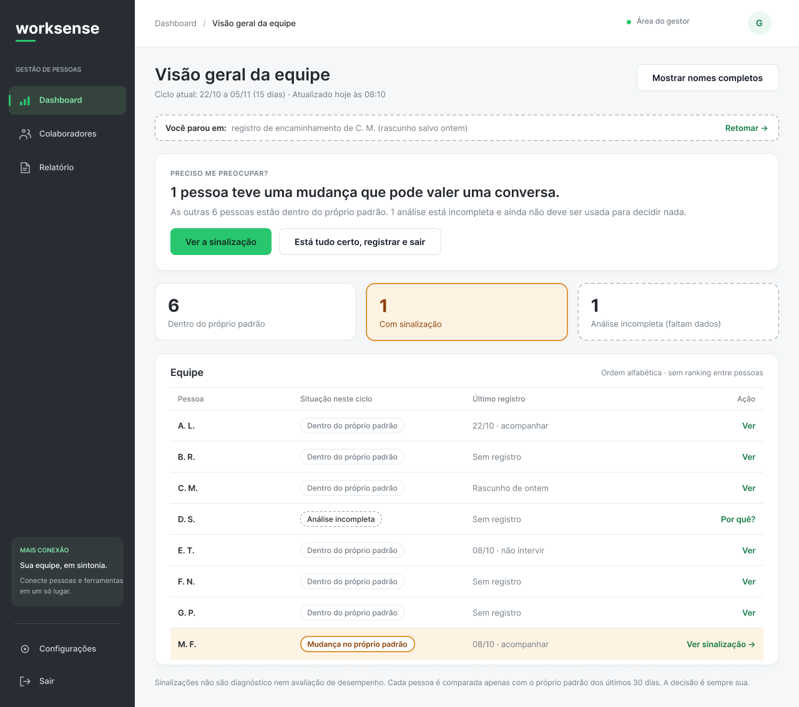

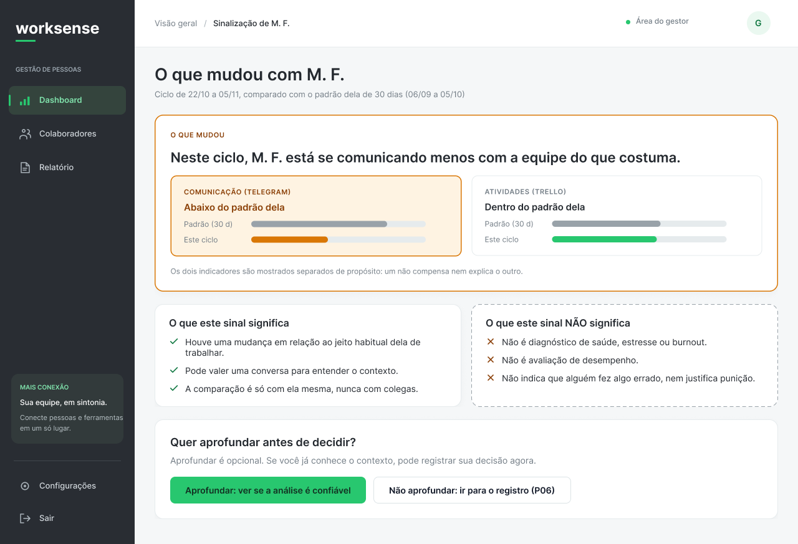

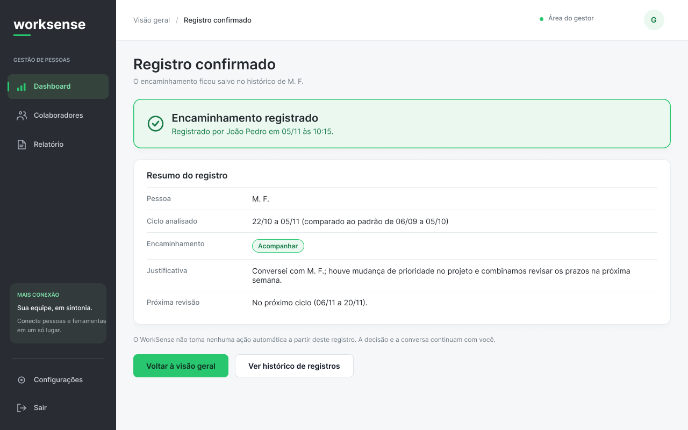

#### Figura V15

#### Figura V16

#### Figura V17

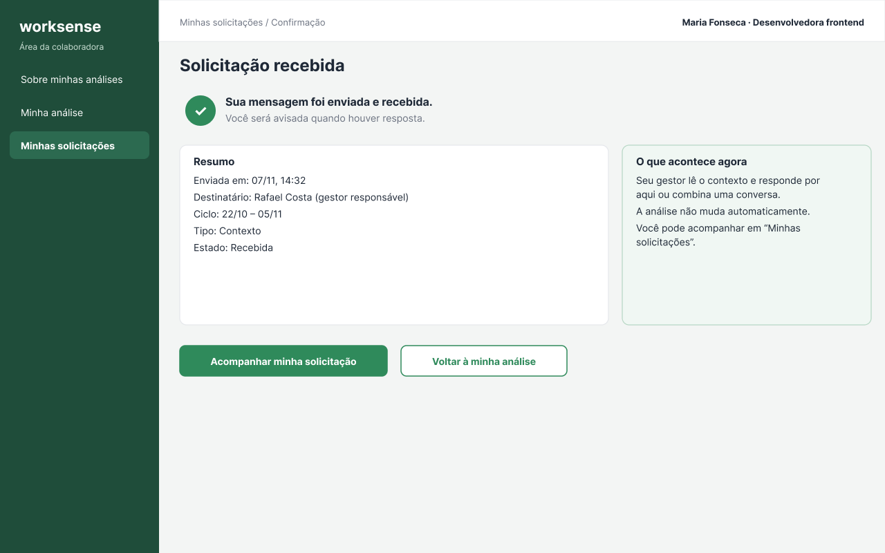

#### Figura V18

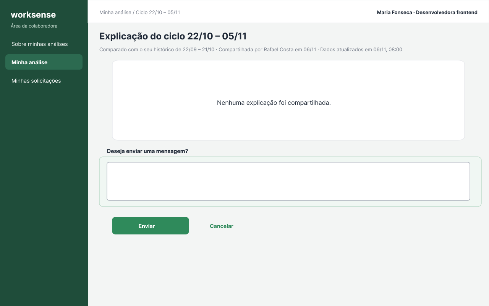

#### Figura V19

#### Figura V20

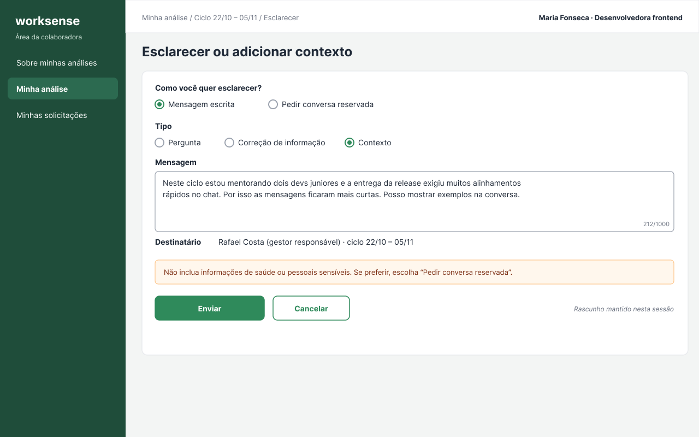

#### Figura V21

#### Figura V22

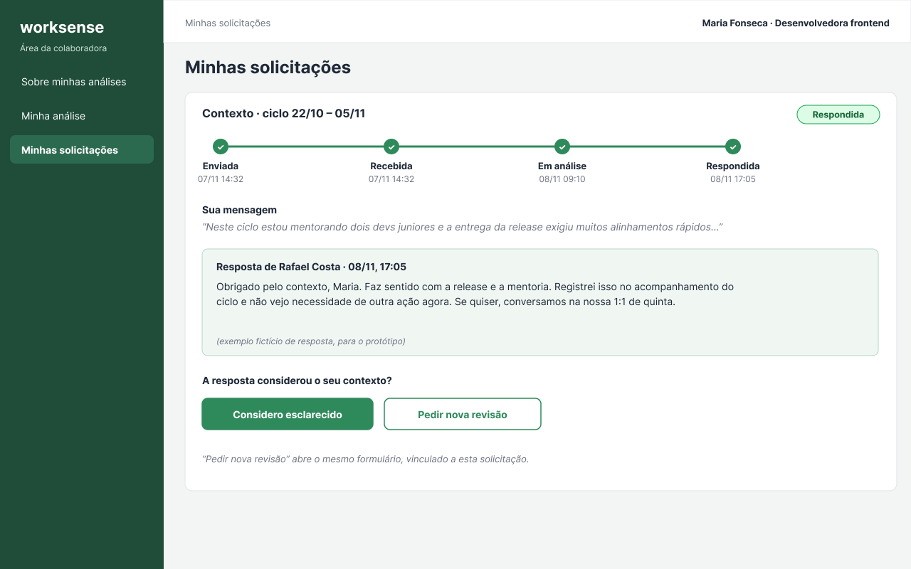

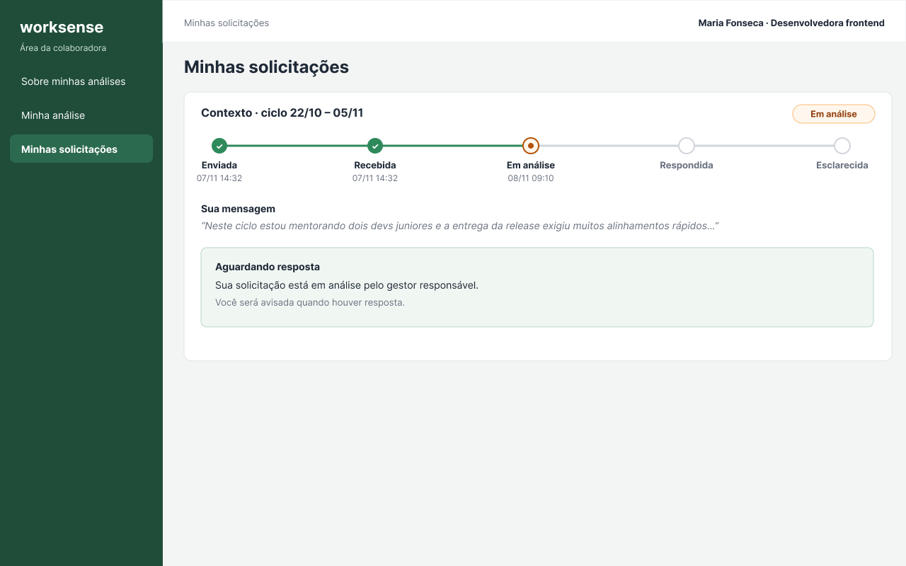

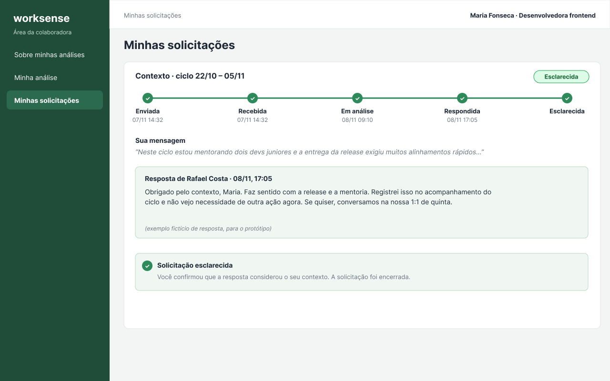

#### Figura V23

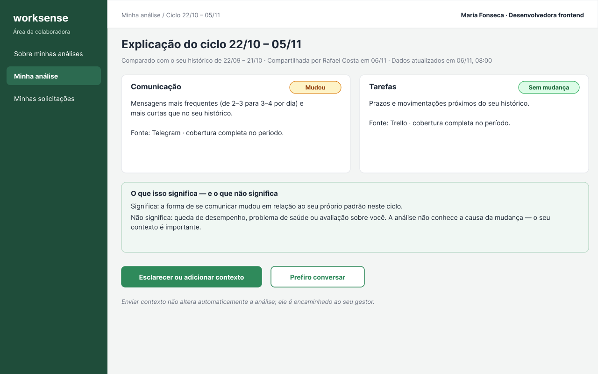

#### Figura V24

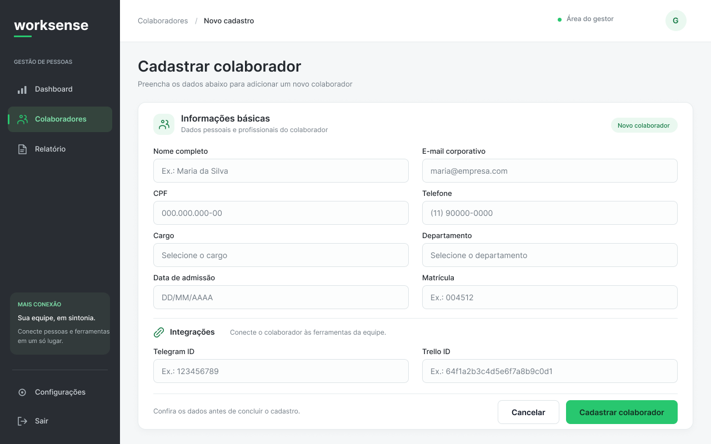

#### Figura V25

#### Figura V26

#### Figura V27

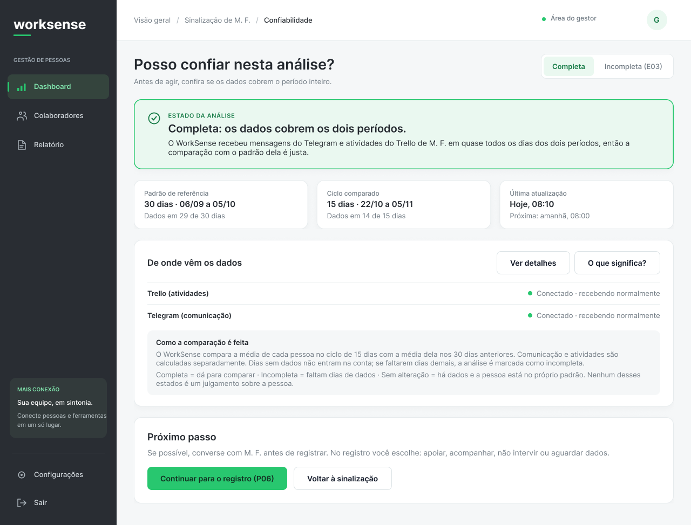

### 6. Boas práticas — heurísticas não violadas (atividade didática)

| Heurística sem violação identificada | Exemplo no sistema | Evidência | Por que atende |
|---|---|---|---|
| H3 — Controle e liberdade do usuário | Confirmação de descarte em F16-sair | [Figura B01 — A03](#figura-b01--a03) | Apresenta as consequências do descarte e oferece a opção de continuar editando. |
| H7 — Flexibilidade e eficiência de uso | Opção “Retomar” na visão geral do gestor | [Figura B02 — A03](#figura-b02--a03) | Representa um caminho direto para retornar a uma atividade interrompida. |
| H8 — Estética e design minimalista | Organização da página “Sobre minhas análises” em quatro cartões | [Figura B03 — A03](#figura-b03--a03) | Agrupa informações relacionadas, utilizando títulos específicos e uma estrutura visual organizada. |
| H9 — Reconhecimento, diagnóstico e recuperação de erros | Mensagem de falha no envio em F16-E2 | [Figura B04 — A03](#figura-b04--a03) | Informa o problema, apresenta o texto preservado e oferece uma alternativa de recuperação. |

#### Figura B01 — A03

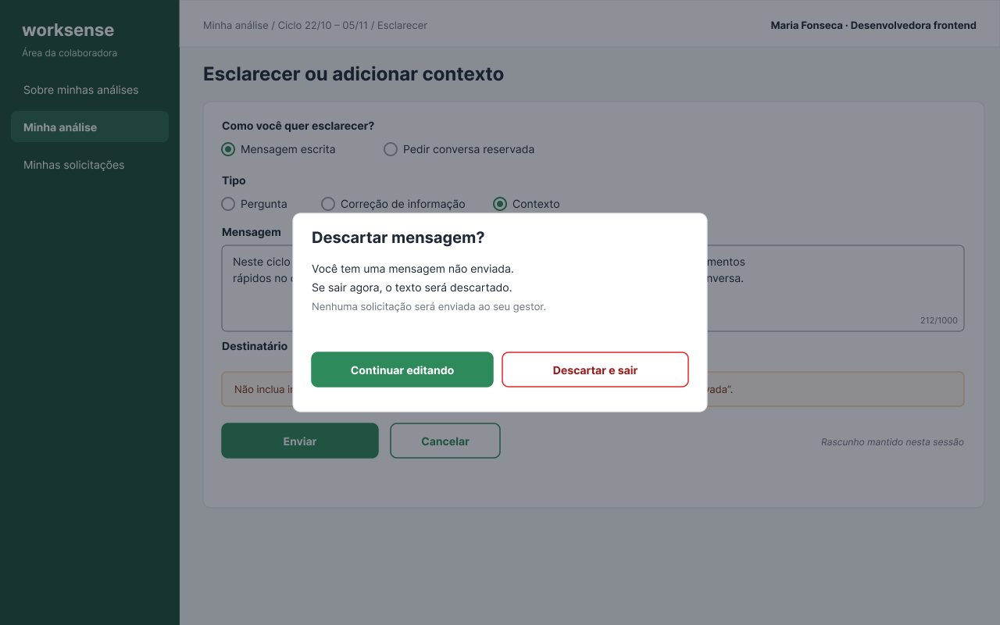

#### Figura B02 — A03

#### Figura B03 — A03

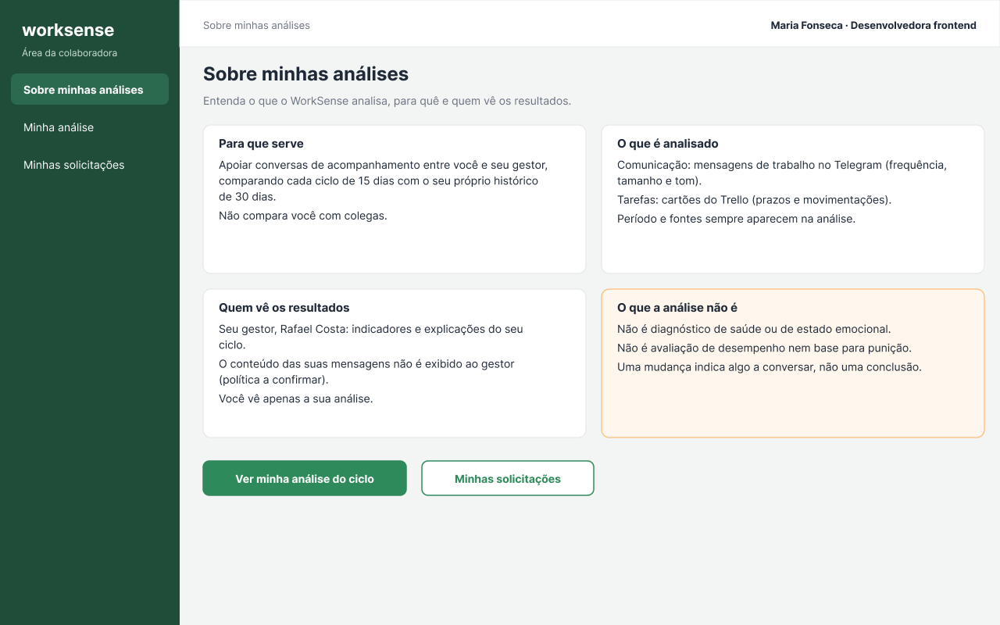

#### Figura B04 — A03

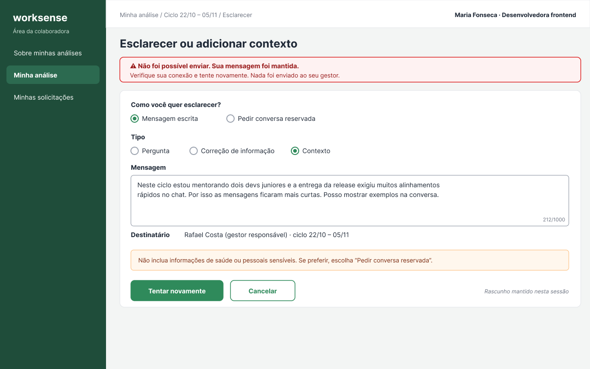

## 7. Consolidação da equipe

Problemas iguais ou muito semelhantes encontrados por avaliadores diferentes devem ser consolidados, preservando quem os encontrou.

| ID consolidado | Achados individuais | Heurística | Problema | Severidade final | Prioridade | Responsável pela correção |
|---|---|---|---|---:|---|---|
| HC01 | V01 | H4, H5 | F12 apresenta “Apoiar” e “Aguardar dados” selecionados simultaneamente, apesar de permitir apenas aguardar dados. | Proposta: 3 — maior; validar com a equipe | Alta — corrigir antes do teste do estado incompleto | Proposta: Caio Arnoni, em alinhamento com o responsável pela edição do protótipo |
| HC02 | V02 | H4 | F10 mostra “Apoiar”, mas F11 confirma “Acompanhar”, sem alteração intermediária documentada. | Proposta: 3 — maior, se confirmado no mesmo fluxo | Alta — verificar o encadeamento e corrigir antes do teste de registro | Proposta: Caio Arnoni, em alinhamento com o responsável pela edição do protótipo |
| HC03 | V03 (A01); V25 (A03) | H2 | F06 oferece “Está tudo certo, registrar e sair” mesmo apresentando sinalização e insuficiência de dados. | Proposta: 2 — menor; validar com a equipe | Baixa em relação a HC01/HC02; incluir na revisão anterior ao teste | Proposta: Caio Arnoni, em alinhamento com o responsável pela edição do protótipo |
| HC04 | V10 (A02) | H10, H5 | Telegram ID e Trello ID sem orientação de onde encontrar | Proposta: 3 — maior; validar com a equipe | Alta — corrigir antes do teste | Proposta: Guilherme Matias |
| HC05 | V08 (A02) | H8, H5 | Campos de cadastro fora da tarefa modelada (CPF, cargo, departamento, admissão, matrícula) | Proposta: 3 — maior; validar com a equipe | Alta — decidir se são necessários | Proposta: Guilherme Matias, com a equipe |
| HC06 | V05, V07 (A02) | H5, H10 | "Lembrar de mim" sem explicação e "Fale com o RH" sem canal | Proposta: 2 — menor | Média | Proposta: Guilherme Matias |
| HC07 | V04, V13 (A02) | H2, H8 | Painel promocional e elementos decorativos sem relação com a tarefa | Proposta: 2 — menor | Média | Proposta: Guilherme Matias |
| HC08 | V09, V11 (A02); V24 (A03) | H5, H4 | Obrigatoriedade não indicada e listas sem aparência de seleção | Proposta: 2 — menor | Média | Proposta: Guilherme Matias |
| HC09 | V06, V12 (A02) | H5, H4 | Senha sem mostrar ou ocultar e identidade visual diferente entre as telas | Proposta: 1 — cosmético | Baixa | Proposta: Guilherme Matias |
| HC10 | V14 (A03) | H4 | Dimensões inconsistentes entre as telas do gestor | Proposta: 2 — menor | Média | Proposta: Caio Arnoni |
| HC11 | V15 (A03) | H5 | Opção de registro sem apresentação prévia da confiabilidade dos dados | Proposta: 3 — maior | Alta | Proposta: Caio Arnoni |
| HC12 | V16 (A03) | H2, H10 | Barras comparativas sem valores ou unidades de medida | Proposta: 2 — menor | Média | Proposta: Caio Arnoni |
| HC13 | V17 (A03) | H4 | Inconsistência dos nomes fictícios utilizados nas confirmações | Proposta: 1 — cosmético | Baixa | Proposta: Caio Arnoni |
| HC14 | V18 (A03) | H1, H4 | Informações contraditórias sobre o compartilhamento da explicação | Proposta: 2 — menor | Média | Proposta: Tainá Cunha Bueno |
| HC15 | V19 (A03) | H5, H6 | Ausência de identificação do destinatário na F15-vazio | Proposta: 3 — maior | Alta | Proposta: Tainá Cunha Bueno |
| HC16 | V20 (A03) | H5 | Ausência ou posicionamento inadequado dos avisos sobre dados sensíveis | Proposta: 2 — menor | Média | Proposta: Tainá Cunha Bueno |
| HC17 | V21 (A03) | H1, H2 | Ambiguidade entre recebimento da solicitação e leitura pelo gestor | Proposta: 2 — menor | Média | Proposta: Tainá Cunha Bueno |
| HC18 | V22 (A03) | H4 | Inconsistência na quantidade de etapas da linha do tempo | Proposta: 2 — menor | Média | Proposta: Tainá Cunha Bueno |
| HC19 | V23 (A03) | H5 | Aviso sobre os efeitos do envio apresentado depois dos botões de ação | Proposta: 2 — menor | Média | Proposta: Tainá Cunha Bueno |
| HC20 | V26 (A03) | H2, H4 | Divergência não explicada entre as descrições dos indicadores nos dois fluxos | Proposta: 2 — menor | Média | Proposta: Caio Arnoni e Tainá Cunha Bueno |
| HC21 | V27 (A03) | H4 | Períodos de referência divergentes entre os fluxos | Proposta: 2 — menor | Média | Proposta: Caio Arnoni e Tainá Cunha Bueno |

---

## Checklist

- [ ] Cada integrante fez uma inspeção completa e identificada.
- [ ] Todas as telas/estados relevantes foram examinados.
- [ ] Estados administrativos, filtros, relatórios, históricos, processamento e erros foram incluídos quando existentes.
- [ ] A inspeção avaliou a interface/protótipo, não o mérito técnico do algoritmo/modelo.
- [ ] H1–H10 aparecem na matriz de cobertura de cada avaliador.
- [ ] Parte de violações contém apenas violações, sem “forçar” exemplos.
- [ ] Todo problema tem print/localização e contexto.
- [ ] Severidade possui justificativa, não apenas número.
- [ ] Recomendação resolve a causa ou reduz o impacto.
- [ ] Achados duplicados foram consolidados ao final.
